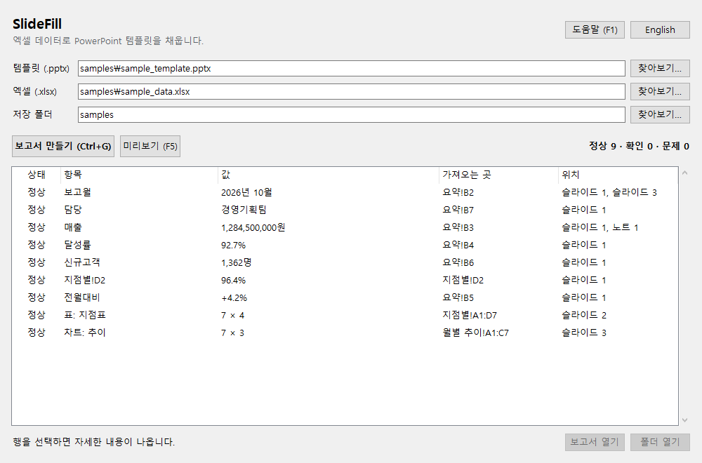

[English](README.md) | **한국어**

# SlideFill

엑셀 데이터로 PowerPoint 템플릿을 채웁니다. 매주·매월 한 시간씩 복사해 붙이던 보고서를 키 한 번으로 만듭니다.



## 왜 만들었나

정기 보고서는 숫자만 바뀌는 같은 슬라이드입니다. 손으로 옮기면 오래 걸리고, 틀린 숫자도 그렇게 들어갑니다. SlideFill은 옮기는 일을 대신하고, 만들기 전에 모든 값을 먼저 보여 줍니다.

## 기능

- **텍스트**: `{{매출}}` 또는 `{{요약!B3}}`을 텍스트 상자, 표 칸, 그룹, 노트, 차트 제목, 슬라이드 마스터 어디에나 쓸 수 있습니다. 글꼴과 색은 그대로입니다.
- **표**: 범위로 PowerPoint 표를 채우고, 행은 데이터에 맞춰 늘거나 줄어듭니다. 합계 행은 맨 아래에 남습니다.
- **차트**: 차트 스타일은 두고 데이터만 바꿉니다. PowerPoint의 "데이터 편집"에도 새 숫자가 나옵니다.
- **매일 쌓이는 데이터**: `{{최신:일별!A,C}}`는 A열에서 가장 최근 날짜를 찾으므로, 행 번호를 템플릿에서 고칠 필요가 없습니다.
- **직접 계산하는 수치**: 전주 같은 요일, 직전 값, 최근 평균 대비 변화와 보고 문장을 코드로 계산하고, 비교한 날짜도 보여 줍니다.
- **실제로 쌓이는 모양 그대로**: 날짜마다 여러 행, 가로로 펼친 기간, 여러 시트, 날짜 없는 표의 구성비와 순위. 집계 시트를 먼저 만들지 않아도 됩니다.
- **엑셀에 보이는 그대로**: `85.3%`, `1,234,567원`, `2026년 11월 3일`. 실제 Excel과 비교해 확인했습니다(아래 참고).
- **먼저 미리보기**: 만들기 전에 모든 값과 출처를 목록으로 보여 줍니다.
- **조용한 빈칸 없음**: 채우지 못한 것은 `{{자리표시자}}` 그대로 눈에 보이게 남고, 문제로 표시되며, 계속할지 먼저 묻습니다.
- **원본은 그대로**: 템플릿과 엑셀은 읽기만 합니다. 보고서는 날짜가 붙은 새 파일이고 다른 파일을 덮어쓰지 않습니다.
- **직접 고르는 통찰 후보** (선택): 내 PC의 모델이 계산 결과를 읽고 문장을 제안합니다. 검사를 거치지만, 직접 고르기 전에는 보고서에 들어가지 않습니다.
- **PC 밖으로 나가지 않음**: 계정도 인터넷 연결도 없고, 실행에 Office가 필요하지 않습니다. 선택 기능인 통찰 단계는 이 PC의 Ollama하고만 통신합니다. 영어와 한국어를 지원합니다.

## 설치

아직 공개 릴리스가 없으니 소스에서 빌드하세요(아래). 결과물은 포터블 `SlideFill.exe` 하나이고, 설치와 관리자 권한이 필요 없습니다.

## 소스에서 빌드

Windows 10/11, [uv](https://docs.astral.sh/uv/) 필요:

```bat
uv venv --python 3.14 .venv
uv pip install --python .venv\Scripts\python.exe openpyxl python-pptx pyinstaller
build.bat
```

`build.bat`은 단위 테스트를 돌리고, `dist\SlideFill.exe`를 만든 뒤, 그 exe로 샘플 파일을 실제로 채워 봅니다. 하나라도 실패하면 멈춥니다.

## 사용법

**1. PowerPoint에서 템플릿에 표시합니다.**

| 하고 싶은 것 | 입력 위치 | 입력 내용 |
|---|---|---|
| 텍스트에 값 넣기 | 텍스트 안 | `{{매출}}`(엑셀 이름 정의) 또는 `{{요약!B3}}` |
| 표 채우기 | 표의 대체 텍스트 | `{{표:요약!A1:D10}}` 또는 `{{표:매출표}}` |
| 차트 채우기 | 차트의 대체 텍스트 | `{{차트:요약!A1:D5}}` 또는 `{{차트:추이범위}}` |

대체 텍스트는 표나 차트를 우클릭한 뒤 **대체 텍스트 보기**에서 입력합니다. 이 표시는 완성된 보고서에서 지워집니다. 영어 `{{table:...}}`, `{{chart:...}}`도 됩니다.

- 표는 왼쪽 위 칸부터 채우므로 범위에 머리글 행을 포함하세요. 열 수는 같아야 합니다.
- 차트는 첫 행을 계열 이름으로, 첫 열을 항목으로 읽습니다.
- 이름 정의나 엑셀 표를 권합니다. 행이 밀려도 계속 맞고, 엑셀 표는 데이터가 늘면 함께 늘어납니다.

매일 행이 늘어나는 시트는 날짜 열을 맨 앞에 적으면 날짜로 가장 최근 행을 찾습니다.

| 하고 싶은 것 | 입력 내용 |
|---|---|
| 가장 최근 날짜의 값 | `{{최신:일별!A,C}}` (A열 날짜 기준, C열 값) |
| 가장 최근 날짜 | `{{최신:일별!A}}` |
| 최근 7행을 표로 | 대체 텍스트: `{{표:최신7:일별!A,C,D}}` |
| 최근 7행을 차트로 | 대체 텍스트: `{{차트:최신7:일별!A,C,D}}` |

- 날짜는 실제 엑셀 날짜나 `2026/11/03`, `2026.11.03`, `2026년 11월 3일`, `20261103`, `2026-11` 같은 글자를 읽습니다. `소계` 같은 행은 날짜가 없어 건너뜁니다.
- 미리 적어 둔 미래 날짜처럼 값이 아직 없는 행도 건너뜁니다. 더 최근 행의 다른 열에는 값이 있고 이 열만 비어 있으면 이전 값을 쓰되 경고합니다. 보고서에 두 날짜가 섞일 수 있기 때문입니다.
- 가장 최근 날짜에 값이 다른 행이 여러 개면 자리표시자를 그대로 두고 문제로 알려 줍니다.
- 열은 붙어 있지 않아도 되고(`A,C,J`), `A:D`는 A열부터 D열까지입니다.
- 표는 템플릿의 머리글 행을 그대로 둡니다. 그 행이 비어 있으면 시트에서 가져옵니다. 차트 계열 이름은 항상 시트에서 가져옵니다. 첫 날짜 행 위에서 가장 가까운, 값이 있는 칸입니다.
- 목록에 사용한 날짜 범위가 나오니 만들기 전에 확인하세요. 날짜가 오래됐다면 엑셀이 갱신되지 않은 것입니다.

**표기를 외우지 않아도 됩니다.** 엑셀을 고르고 **Ctrl+R**을 누르면 SlideFill이 시트 모양을 읽어, 쓸 수 있는 참조를 실제 결과와 함께 보여 줍니다. 하나를 복사해 넣거나, **초안 템플릿 저장**으로 문장, 표, 차트가 이미 들어간 템플릿을 만들 수 있습니다. 첫 제안은 자동 판단이니 수치와 조건이 원하는 것인지 확인하세요. 안 맞으면 창에서 시트, 수치, 조건을 바꾸면 바로 다시 계산합니다.

데이터 모양이 달라도 위와 아래의 표기 어디에나 쓸 수 있습니다. 추측으로 더하지 않으므로, 행은 `합계`라고 적을 때만 더합니다.

| 데이터 모양 | 입력 내용 |
|---|---|
| 날짜마다 여러 행 | `{{최신:일별!A,합계(D:E)}}`, 행 수는 `건수(C)`, 수량×단가는 `합계(D*E)` |
| 일부 행만 | `{{읽는법:일별!A,합계(D, B=민원)}}` (B열이 정확히 민원인 행. 그런 칸이 없으면 민원이 들어간 행) |
| 평균, 행의 비율 | `평균(D)`, `비율(B=Yes)` (날짜별 또는 이름별) |
| 연도와 월이 다른 열 | `{{최신:월별!A+B,C}}` (A열 연도, B열 월) |
| 기간이 가로로 펼쳐짐 | `{{최신:월별!5,7}}` (5행에 기간, 7행에 값) |
| 한 시트에 표 두 개 | `{{최신:지수!A10:A475,C10:C475}}` |
| 연도별로 나뉜 시트 | `{{읽는법:실적*!A,C}}` (실적으로 시작하는 시트를 이어서) |

날짜 없는 표는 첫 열을 항목 이름으로 읽습니다.

| 하고 싶은 것 | 입력 내용 |
|---|---|
| 가장 큰 항목과 구성비 | `{{읽는법:표!A,B}}` |
| 두 기간 사이 증감 | `{{읽는법:표!A,B,C}}` |
| 가장 큰 항목의 이름, 값, 구성비 | `{{순위1:표!A,B}}`, `{{순위값1:표!A,B}}`, `{{구성비1:표!A,B}}` |
| 상위 5개 표와 차트 | 대체 텍스트: `{{표:구성비5:표!A,B}}`, `{{차트:순위5:표!A,B}}` |

시트에 합계가 없으면 "전체" 대신 "항목 합계"라고 쓰고 경고합니다. 지수나 평균처럼 더할 수 없는 값인지는 머리글과 시트 이름으로 판단하므로, 경고를 확인하세요. `Ⅰ.`, `1.`, `(1)`처럼 계층 번호가 있는 표는 최상위 항목만 비교합니다.

경고는 앱 목록에만 나오고 슬라이드에는 인쇄되지 않습니다. 그래서 값을 다르게 읽어야 하는 경우(덜 쌓인 기간, 결측 뒤의 값, 일찍 끊긴 날)는 `해설`과 `읽는법` 문장 자체에 적습니다. `전일대비` 같은 수치 하나만 쓰면 이 말이 들어갈 자리가 없으니 경고를 확인하세요.

날짜 열과 값 열 하나로 수치를 직접 계산할 수도 있습니다. 텍스트 안에 씁니다.

| 하고 싶은 것 | 입력 내용 |
|---|---|
| 전주 같은 요일 대비 변화 | `{{전주대비:일별!A,C}}` |
| 직전 값 대비 변화 | `{{전일대비:일별!A,C}}` 또는 `{{직전대비:일별!A,C}}` |
| 직전 7개 평균 대비 변화 | `{{평균대비7:일별!A,C}}` (최신 값은 자기 평균에 넣지 않습니다) |
| 최근 30개 중 가장 높은 날, 낮은 날 | `{{최고일30:일별!A,C}}`, `{{최저일30:일별!A,C}}` |
| 이 수치를 담은 보고 문장 | `{{해설:일별!A,C}}` |
| 수치를 읽는 법 | `{{읽는법:일별!A,C}}` |

`읽는법`에는 모델도 GPU도 필요 없습니다. 정해진 규칙이 판단하므로 같은 데이터는 항상 같게 읽힙니다. 비교가 오해를 부를 때(평균에 섞인 주말, 일요일과 비교한 월요일, 전주 같은 요일이 연휴였던 경우, 낮았던 직전 달과의 비교, 1년치와 일부 기간의 비교), 값이 그 요일의 평소 범위를 벗어났을 때, 최근 하루가 평균을 움직였을 때 그 크기와 함께 알려 줍니다. 월별·분기별 데이터는 전년 같은 기간을 먼저 봅니다. 원인을 단정하지 않고, 확인할 것만 짚어 줍니다.

정확히 7일 전 행이 없거나 기준값이 0처럼 비교할 값이 없으면, 자리표시자를 그대로 두고 문제로 표시합니다. 목록에는 비교한 날짜가 나옵니다.

수치를 읽어 주는 문장이 필요하면 텍스트에 `{{통찰:일별!A,C}}`를 쓰고 **Ctrl+I**를 누릅니다.

1. SlideFill이 수치를 계산하고, 비교 기준이 엇갈리는 경우처럼 주목할 점을 찾습니다.
2. 템플릿과 시트의 한글과 영문 글자 수를 세어 해당 언어의 모델을 고릅니다.
3. 모델이 그 결과로 후보를 씁니다. 모델에게 계산을 시키지 않습니다.
4. 근거에 없는 숫자, 단정한 원인, 알려진 오독이 있는 문장은 검사에서 뺍니다.
5. 남은 문장을 근거와 대조해 읽고, 원하는 문장을 추가하고 고칩니다.

고르기 전에는 계산 해설 문장이 들어가고 목록에 그렇게 표시됩니다. 수치가 바뀌면 예전 수치로 고른 문장은 다시 쓰지 않습니다. **검사가 의미 오류까지 다 잡지는 못합니다. 시험에서 가장 나은 모델의 한국어 문장도 약 6개 중 1개가 틀렸으니, 꼭 읽고 사용하세요.**

이 단계에는 [Ollama](https://ollama.com)와 최대 8GB의 비디오 메모리가 필요합니다. 나머지 기능은 없어도 동작합니다. 설치 방법:

```bat
ollama pull hf.co/mykor/A.X-4.0-Light-gguf:Q4_K_M
ollama pull qwen3.5:4b
```

**2. 템플릿과 엑셀을 고릅니다.** 무엇이 어디로 들어가는지 목록에 나옵니다. 새로 고치려면 F5를 누르세요.

**3. Ctrl+G를 누릅니다.** 파일 경로를 기억하므로 다음 달에는 켜서 Ctrl+G만 누르면 됩니다.

`samples/sample_template.pptx`와 `samples/sample_data.xlsx`로 바로 해 볼 수 있습니다.

### 알아 두세요

- 엑셀에 마지막으로 **저장된** 값을 읽습니다. 엑셀을 먼저 저장하세요.
- 암호나 문서 보안(DRM)이 걸린 파일은 읽지 못하고, 그렇다고 알려 줍니다.
- `.xls`, `.ppt`는 지원하지 않습니다. `.xlsm`은 읽지만 매크로는 실행하지 않습니다.
- SmartArt 안의 자리표시자는 채우지 못하고 문제로 알려 줍니다.
- `OFFSET(...)` 같은 동적 이름은 해석하지 못합니다. 엑셀 표를 쓰세요.
- 드문 표시 형식(분수, `[DBNum1]`, `[>=100]` 같은 조건)은 경고와 함께 원래 값을 넣습니다.
- 천 단위와 소수점 기호는 항상 `,`와 `.`입니다.

## 어떻게 확인했나

| 주장 | 확인 |
|---|---|
| 숫자가 엑셀과 같다 | `tools/compare_with_excel.py`가 실제 Excel에 100개가 넘는 값과 형식을 표시하게 한 뒤 하나씩 비교 |
| 보고서가 깨끗하게 열린다 | `tools/verify_powerpoint.ps1`이 실제 PowerPoint로 보고서와 각 차트의 데이터를 열어 봄 |
| 창이 동작한다 | `tools/gui_check.py`가 단축키와 대화상자를 실행, `tools/gui_check.ps1`이 실제 exe를 실행 |
| 나머지 | `build.bat`이 매번 돌리는 `test_core.py` |
| 읽는 법 규칙이 맞는 날에 발동한다 | 2022~2025년 실제 공개 데이터의 모든 날짜에 실행. [동작 방식](doc/how-it-works.ko.md) 참고 |

Excel과 PowerPoint 확인에는 Office가 필요하고, 형식 비교 결과는 그 PC의 국가별 설정을 따릅니다. 자세한 내용: [동작 방식](doc/how-it-works.ko.md).

## 프로젝트 구성

```
app.py              창
core.py             엑셀 읽기, 템플릿 채우기 (GUI 없음)
numfmt.py           값을 엑셀 표시대로 변환
i18n.py             영어·한국어 문구
test_core.py        단위 테스트
build.bat           테스트, 빌드, 스모크 테스트
tools/              실제 Office 확인, 샘플, 노티스
samples/            직접 만든 예시 파일
```

## 기여자

- **hobby programmer**: 아이디어, 요구사항, 테스트
- **Claude**: 설계와 구현

## 라이선스

아직 정하지 않았습니다. 함께 들어가는 구성요소는 [THIRD-PARTY-NOTICES.md](THIRD-PARTY-NOTICES.md)에 있습니다.
