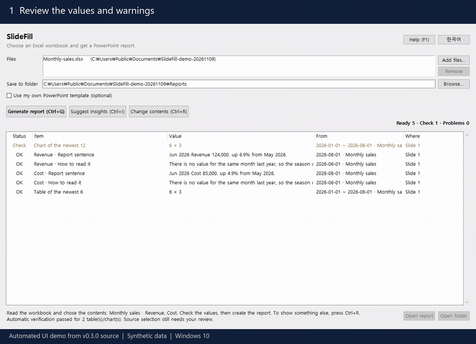

[English](README.md) | **한국어**

# SlideFill

엑셀만 고르면 PowerPoint 보고서를 만듭니다. 회사 템플릿이 있으면 거기에 채울 수도 있습니다. 매주·매월 한 시간씩 복사해 붙이던 보고서를 키 한 번으로 만듭니다.

> [!IMPORTANT]
> **공유하기 전에 보고서를 검토하세요.** SlideFill은 명시적인 규칙으로 계산하고 지원하는 값과 저장 결과를 검사합니다. 선택 기능인 AI는 문장을 제안합니다. 검증 통과가 원본의 정확성, 업무상 의미나 모든 Office 배치를 보증하지는 않습니다.
>
> 선택한 시트·지표·집계 방식·기간·단위와 경고를 확인하고 완성된 보고서를 살펴보세요. **내용 바꾸기(Ctrl+R)**로 엑셀만으로 만든 보고서의 선택을 조정할 수 있습니다. 수식을 재계산해 저장한 파일을 사용하세요. [아직 릴리스하지 않은 신뢰성 개선](doc/reliability-hardening.ko.md)은 제한된 수식 캐시·텍스트 검사와 독립 검산 미완료 시 저장 거절을 추가하며, 배포된 v0.3.0 EXE에는 포함되지 않습니다.

[](https://github.com/hobby-programmer-5000/slidefill/releases/download/v0.3.0/SlideFill-demo.mp4)

[데모 영상 보기(MP4)](https://github.com/hobby-programmer-5000/slidefill/releases/download/v0.3.0/SlideFill-demo.mp4). 직접 만든 가상 자료로, Windows 10에서 배포판과 같은 소스의 UI를 자동 실행합니다. 완성 보고서는 호스트의 PowerPoint로 렌더링합니다.

## 왜 만들었나

정기 보고서는 숫자만 바뀌는 같은 슬라이드입니다. 손으로 옮기면 오래 걸리고, 틀린 숫자도 그렇게 들어갑니다. SlideFill은 옮기는 일을 대신하고, 만들기 전에 모든 값을 먼저 보여 줍니다.

## 기능

- **엑셀만으로 보고서**: 파일을 고르면 시트 모양을 읽어 내용을 고르고, 실제 값을 먼저 보여 줍니다. 수치를 잘못 골랐다면 Ctrl+R로 바꿉니다. 자동 판단이니 만들기 전에 값을 확인하세요.
- **자신 없으면 묻기**: 합치면 뜻이 없어 보이는 값을 더했거나, 줄 수만 셌거나, 표가 여러 개 쌓여 있거나, 비교한 기간의 값이 대부분 비어 있거나, 퍼센트 사이에 사람 수가 섞였거나, 여러 줄이 병합된 이름 하나를 함께 쓰거나, 줄마다 값이 같아 뺀 열의 합계가 이름 없는 아래 줄에만 있는 등 잘못 골랐을 징후가 있으면 보고서를 만들기 전에 이유를 보여 주고 묻습니다. 그대로 만들기로 하면 슬라이드에 확인되지 않은 값이라고 적습니다. 모든 오류를 잡지는 못합니다.
- **값의 뜻 지키기**: 발열량이나 농도처럼 더할 수 없는 값은 평균으로, 시트에 단위가 퍼센트라고 적힌 값은 퍼센트와 포인트로 씁니다. 아직 끝나지 않은 기간은 다른 기간과 비교하지 않습니다. 같은 해의 실적과 예산이 나란하면 예산 대비로 읽고, 재무제표처럼 수입과 지출 줄이 섞인 표는 줄끼리 순위를 매기지 않고 합계 줄을 적습니다.
- **텍스트**: `{{매출}}` 또는 `{{요약!B3}}`을 텍스트 상자, 표 칸, 그룹, 노트, 차트 제목, 슬라이드 마스터 어디에나 쓸 수 있습니다. 글꼴과 색은 그대로입니다.
- **표**: 범위로 PowerPoint 표를 채우고, 행은 데이터에 맞춰 늘거나 줄어듭니다. 합계 행은 맨 아래에 남습니다.
- **차트**: 차트 스타일은 두고 데이터만 바꿉니다. PowerPoint의 "데이터 편집"에도 새 숫자가 나옵니다.
- **매일 쌓이는 데이터**: `{{최신:일별!A,C}}`는 A열에서 가장 최근 날짜를 찾으므로, 행 번호를 템플릿에서 고칠 필요가 없습니다.
- **직접 계산하는 수치**: 전주 같은 요일, 직전 값, 최근 평균 대비 변화와 보고 문장을 코드로 계산하고, 비교한 날짜도 보여 줍니다.
- **실제로 쌓이는 모양 그대로**: 날짜마다 여러 행, 가로로 펼친 기간, 여러 시트, 날짜 없는 표의 구성비와 순위. 집계 시트를 먼저 만들지 않아도 됩니다.
- **엑셀에 보이는 그대로**: `85.3%`, `1,234,567원`, `2026년 11월 3일`. 실제 Excel과 비교해 확인했습니다(아래 참고).
- **먼저 미리보기**: 만들기 전에 모든 값과 출처를 목록으로 보여 줍니다.
- **조용한 빈칸 없음**: 채우지 못한 것은 `{{자리표시자}}` 그대로 눈에 보이게 남고, 문제로 표시되며, 계속할지 먼저 묻습니다.
- **원본은 그대로**: 템플릿과 엑셀은 읽기만 합니다. 보고서는 날짜가 붙은 새 파일이고 다른 파일을 덮어쓰지 않습니다.
- **직접 고르는 통찰 문장** (선택): 숫자가 무슨 뜻인지 짚어 주는 한 문장입니다. 보고받는 사람이 표를 직접 해석하지 않아도 요점을 알 수 있습니다. 내 PC의 모델이 계산 결과를 읽고 제안합니다. 검사를 거치지만, 직접 고르기 전에는 보고서에 들어가지 않습니다.
- **PC 밖으로 나가지 않음**: 계정도 인터넷 연결도 없고, 실행에 Office가 필요하지 않습니다. 선택 기능인 통찰 단계는 이 PC의 Ollama하고만 통신합니다. 영어와 한국어를 지원합니다.

## 정확성과 지원 범위

SlideFill은 지원하는 값과 저장 표현을 자동 검사하지만 원본 자료가 사실인지, 선택한 지표가 업무 질문에 맞는지, 모든 입력 형식과 Office 배치가 정확한지까지 보장하지 않습니다. 보고서를 사용하기 전에 시트·기간·단위·조건과 경고를 확인하세요.

개발 소스는 정확한 유리수로 계산 중간값을 유지하고 제한된 저장 수식·수치 텍스트 자리표시자를 독립 검산하며, 확정된 불일치와 **부분 검증 모두 저장을 막습니다**. 여전히 Excel에서 원본을 재계산하지 않고 저장 파일을 읽으며 모든 문장·배치를 보증하지는 않습니다. [정확한 계약과 남은 경계](doc/reliability-hardening.ko.md)를 참고하세요. 이 변경은 아직 릴리스하지 않았고 v0.3.0에는 릴리스 노트의 기존 표·차트 검사가 적용됩니다.

[자동 검사와 대응 방법](doc/verification.ko.md), [지원 배치](doc/limits.ko.md), [알고리즘·코드 구조·증명 범위](doc/verification-design.ko.md)를 참고하세요. 이 안내는 소스 트리를 설명합니다. 내려받은 실행 파일에 포함된 기능은 해당 릴리스 노트에서 확인하세요.

## 설치

[Releases](https://github.com/hobby-programmer-5000/slidefill/releases)에서 `SlideFill.exe`를 받아 실행하세요. 포터블 파일 하나이고, 설치와 관리자 권한이 필요 없습니다. 설정은 옆의 `SlideFill.json`에 저장되고, 이 파일은 처음 파일을 고르거나 미리보기하거나 언어를 바꿀 때 생깁니다.

exe에 코드 서명이 없어 처음 실행할 때 Windows SmartScreen이 "Windows의 PC 보호"라고 할 수 있습니다. **추가 정보 → 실행**을 누르세요.

v0.3.0은 직접 만든 자료와 공개 자료로 시험한 정식 릴리스입니다. 배포하는 동일 EXE가 Office 없는 새 Windows 10 VM 시험과 호스트의 실제 PowerPoint 렌더링을 통과했습니다. Windows 11과 비공개 회사 파일의 호환성은 미시험입니다. [릴리즈 노트](https://github.com/hobby-programmer-5000/slidefill/releases/tag/v0.3.0)와 [개발·검증 이력](doc/development-history.ko.md)을 참고하세요.

## 소스에서 빌드

Windows 10/11, [uv](https://docs.astral.sh/uv/) 필요:

```bat
uv venv --python 3.14 .venv
uv pip install --python .venv\Scripts\python.exe openpyxl python-pptx xlrd python-calamine pyinstaller
build.bat
```

`build.bat`은 단위 테스트를 돌리고, `dist\SlideFill.exe`를 만든 뒤, 그 exe로 샘플 파일을 실제로 채워 봅니다. 하나라도 실패하면 멈춥니다.

## 사용법

### 엑셀만으로

**1. 엑셀을 고릅니다.** SlideFill이 파일을 읽어 내용을 고르고, 들어갈 값을 목록으로 보여 줍니다. 큰 파일은 몇 분 걸릴 수 있습니다.

**2. 값을 확인합니다.** 어느 시트의 어떤 수치를 골랐는지 창 아래에 나옵니다. 다른 것을 원하면 **Ctrl+R**을 눌러 시트, 수치, 조건을 바꿉니다.

**3. Ctrl+G를 누릅니다.** 엑셀 옆에 `<엑셀 이름>_<날짜>.pptx`가 새로 생깁니다. 다음 달에는 켜서 Ctrl+G만 누르면 됩니다.

잘못 골랐을 징후가 있으면 만들기 전에 이유를 보여 주고 묻습니다. **이대로 만들기**를 고르면 슬라이드에 확인되지 않은 값이라고 적습니다.

**통찰 문장(선택):** 목록에서 수치를 고르고 **Ctrl+I**를 누르면 내 PC의 모델이 계산 결과로 후보 문장을 제안합니다. 고른 문장이 그 수치의 "읽는 법"을 대신합니다. 고르지 않으면 계산 문장 그대로 나갑니다.

시트마다 슬라이드 한 장을 만듭니다. 왼쪽에 문장, 오른쪽에 차트와 표가 들어갑니다. 들어가는 범위는 이렇습니다.

- 수치: 나란히 있는 수치가 4개 이하면 모두 넣습니다(내국인과 외국인처럼). 합계 열이 있거나 수치가 5개 이상이면 하나만 넣고, 넣지 않은 개수를 창에 알려 줍니다.
- 시트: 구성이 같은 시트가 모두 3개 이하면 함께 넣습니다. 시군구별 시트의 시도 줄이 시도별 시트와 같은 말을 하듯 슬라이드 문장이 다른 시트와 똑같으면 넣지 않고 개수에 셉니다. 월별 시트처럼 더 많거나 구성이 다른 시트는 넣지 않고 개수를 알려 줍니다.
- 단위: 시트 이름이나 표 위의 "단위" 문구를 슬라이드에 그대로 적습니다. 다른 곳에만 적혀 있으면 나오지 않습니다.
- 차트: 크기가 10배 넘게 차이 나는 수치는 표에만 넣습니다.
- 표: 큰 숫자에 쉼표를 넣습니다. 템플릿을 쓸 때는 엑셀에 보이는 그대로 둡니다.
- 연도 열: `2025년`, `2024년`처럼 연도별 열이면 최신 연도만 넣습니다.
- 여러 단의 머리글: 기간마다 성별·수치 조합이 같고 실제 병합으로 이름을 확정할 수 있으면 한 조합을 명시해 읽고 확인받습니다. 조합이 빠지거나 중복되거나 서로 다르면 추측하지 않습니다.

슬라이드 구성이 정해져 있다면 아래 템플릿 방식을 쓰세요.

**여러 파일.** 파일을 창에 끌어다 놓거나 **파일 추가**를 누르면, 보고서 첫 장에 종합 슬라이드가 생깁니다. 파일들의 수치가 어느 방향으로 움직였는지 계산한 문장, 파일별 핵심 문장 순서이고 그 뒤에 파일별 슬라이드가 이어집니다. 최신 시점이 다른 파일은 나란히 비교하지 않고 그렇다고 적습니다. **Ctrl+I**의 "모든 파일 함께 보기"를 고르면 모델이 파일들을 함께 보는 문장을 제안합니다. 파일 사이의 인과는 데이터에 없으므로 그렇게 쓴 문장은 뺍니다.

**Word 문서와 함께.** `.docx`를 엑셀과 함께 넣으면 문서용 슬라이드가 생깁니다. 문서에서 날짜로 시작하는 기록을 찾아, 기록에 나온 항목 이름을 엑셀의 수치와 맞추고, 그 시기 전후 평균을 계산해 표로 보여 줍니다. 이는 같은 시기였다는 뜻이며 원인이라는 뜻이 아니고, 슬라이드에도 그렇게 적습니다. 날짜 기록이 없는 문서는 유의할 점과 설명 문단을 그대로 싣고, 문서의 수치가 엑셀에 있는지 확인합니다. 파일이 여럿일 때 문서와 같은 폴더에 엑셀이 하나만 있으면 문서 슬라이드는 그 엑셀 슬라이드 바로 앞에 옵니다. 표 안의 내용, 이미지, `.doc`, `.hwp`는 읽지 않습니다.

**내용 바꾸기.** **Ctrl+R**을 누르면 시트와 수치가 모두 나옵니다. 넣을 것을 체크하면 옆에 그 슬라이드가 그려집니다. **이 내용으로 하기**를 누르기 전에는 보고서가 바뀌지 않습니다.

### 내 템플릿으로

**내 PowerPoint 템플릿 사용**을 켜면 템플릿 칸이 나타납니다.

**1. PowerPoint에서 템플릿에 표시합니다.**

| 하고 싶은 것 | 입력 위치 | 입력 내용 |
|---|---|---|
| 텍스트에 값 넣기 | 텍스트 안 | `{{매출}}`(엑셀 이름 정의) 또는 `{{요약!B3}}` |
| 표 채우기 | 표의 대체 텍스트 | `{{표:요약!A1:D10}}` 또는 `{{표:매출표}}` |
| 차트 채우기 | 차트의 대체 텍스트 | `{{차트:요약!A1:D5}}` 또는 `{{차트:추이범위}}` |

대체 텍스트는 표나 차트를 우클릭한 뒤 **대체 텍스트 보기**에서 입력합니다. 이 표시는 완성된 보고서에서 지워집니다. 영어 `{{table:...}}`, `{{chart:...}}`도 됩니다.

- 표는 왼쪽 위 칸부터 채우므로 범위에 머리글 행을 포함하세요. 열 수는 같아야 합니다.
- 차트는 첫 행을 계열 이름으로, 첫 열을 항목으로 읽습니다.
- 버블 차트 템플릿은 X열 뒤에 Y·크기 열 쌍을 명시합니다. [검증 범위](doc/verification.ko.md)를 참고하세요.
- 이름 정의나 엑셀 표를 권합니다. 행이 밀려도 계속 맞고, 엑셀 표는 데이터가 늘면 함께 늘어납니다.

매일 행이 늘어나는 시트는 날짜 열을 맨 앞에 적으면 날짜로 가장 최근 행을 찾습니다.

| 하고 싶은 것 | 입력 내용 |
|---|---|
| 가장 최근 날짜의 값 | `{{최신:일별!A,C}}` (A열 날짜 기준, C열 값) |
| 가장 최근 날짜 | `{{최신:일별!A}}` |
| 최근 7행을 표로 | 대체 텍스트: `{{표:최신7:일별!A,C,D}}` |
| 최근 7행을 차트로 | 대체 텍스트: `{{차트:최신7:일별!A,C,D}}` |

- 날짜는 실제 엑셀 날짜나 `2026/11/03`, `2026.11.03`, `2026년 11월 3일`, `20261103`, `2026-11` 같은 글자를 읽습니다. `소계` 같은 행은 날짜가 없어 건너뜁니다.
- 미리 적어 둔 미래 날짜처럼 값이 아직 없는 행도 건너뜁니다. 더 최근 행의 다른 열에는 값이 있고 이 열만 비어 있으면 이전 값을 쓰되 경고합니다. 보고서에 두 날짜가 섞일 수 있기 때문입니다.
- 가장 최근 날짜에 값이 다른 행이 여러 개면 자리표시자를 그대로 두고 문제로 알려 줍니다.
- 열은 붙어 있지 않아도 되고(`A,C,J`), `A:D`는 A열부터 D열까지입니다.
- 표는 템플릿의 머리글 행을 그대로 둡니다. 그 행이 비어 있으면 시트에서 가져옵니다. 차트 계열 이름은 항상 시트에서 가져옵니다. 첫 날짜 행 위에서 가장 가까운, 값이 있는 칸입니다.
- 목록에 사용한 날짜 범위가 나오니 만들기 전에 확인하세요. 날짜가 오래됐다면 엑셀이 갱신되지 않은 것입니다.

**표기를 외우지 않아도 됩니다.** 엑셀을 고르고 **Ctrl+R**을 누르면 SlideFill이 시트 모양을 읽어, 쓸 수 있는 참조를 실제 결과와 함께 보여 줍니다. 하나를 복사해 넣거나, **초안 템플릿 저장**으로 문장, 표, 차트가 이미 들어간 템플릿을 만들 수 있습니다. 첫 제안은 자동 판단이니 수치와 조건이 원하는 것인지 확인하세요. 안 맞으면 창에서 시트, 수치, 조건을 바꾸면 바로 다시 계산합니다.

데이터 모양이 달라도 위와 아래의 표기 어디에나 쓸 수 있습니다. 추측으로 더하지 않으므로, 행은 `합계`라고 적을 때만 더합니다.

| 데이터 모양 | 입력 내용 |
|---|---|
| 날짜마다 여러 행 | `{{최신:일별!A,합계(D:E)}}`, 행 수는 `건수(C)`, 수량×단가는 `합계(D*E)` |
| 일부 행만 | `{{읽는법:일별!A,합계(D, B=민원)}}` (B열이 정확히 민원인 행. 그런 칸이 없으면 민원이 들어간 행) |
| 평균, 행의 비율 | `평균(D)`, `비율(B=Yes)` (날짜별 또는 이름별) |
| 연도와 월이 다른 열 | `{{최신:월별!A+B,C}}` (A열 연도, B열 월) |
| 기간이 가로로 펼쳐짐 | `{{최신:월별!5,7}}` (5행에 기간, 7행에 값) |
| 한 시트에 표 두 개 | `{{최신:지수!A10:A475,C10:C475}}` |
| 연도별로 나뉜 시트 | `{{읽는법:실적*!A,C}}` (실적으로 시작하는 시트를 이어서) |

날짜 없는 표는 첫 열을 항목 이름으로 읽습니다.

| 하고 싶은 것 | 입력 내용 |
|---|---|
| 가장 큰 항목과 구성비 | `{{읽는법:표!A,B}}` |
| 두 기간 사이 증감 | `{{읽는법:표!A,B,C}}` (B가 이전, C가 이후. 머리글이 반대로 보이면 경고) |
| 가장 큰 항목의 이름, 값, 구성비 | `{{순위1:표!A,B}}`, `{{순위값1:표!A,B}}`, `{{구성비1:표!A,B}}` |
| 상위 5개 표와 차트 | 대체 텍스트: `{{표:구성비5:표!A,B}}`, `{{차트:순위5:표!A,B}}` |

시트에 합계가 없으면 "전체" 대신 "항목 합계"라고 쓰고 경고합니다. 지수나 평균처럼 더할 수 없는 값인지는 머리글과 시트 이름으로 판단하므로, 경고를 확인하세요. `Ⅰ.`, `1.`, `(1)`처럼 계층 번호가 있는 표는 최상위 항목만 비교합니다.

경고는 앱 목록에만 나오고 슬라이드에는 인쇄되지 않습니다. 그래서 값을 다르게 읽어야 하는 경우(덜 쌓인 기간, 결측 뒤의 값, 일찍 끊긴 날)는 `해설`과 `읽는법` 문장 자체에 적습니다. `전일대비` 같은 수치 하나만 쓰면 이 말이 들어갈 자리가 없으니 경고를 확인하세요.

날짜 열과 값 열 하나로 수치를 직접 계산할 수도 있습니다. 텍스트 안에 씁니다.

| 하고 싶은 것 | 입력 내용 |
|---|---|
| 전주 같은 요일 대비 변화 | `{{전주대비:일별!A,C}}` |
| 직전 값 대비 변화 | `{{전일대비:일별!A,C}}` 또는 `{{직전대비:일별!A,C}}` |
| 직전 7개 평균 대비 변화 | `{{평균대비7:일별!A,C}}` (최신 값은 자기 평균에 넣지 않습니다) |
| 최근 30개 중 가장 높은 날, 낮은 날 | `{{최고일30:일별!A,C}}`, `{{최저일30:일별!A,C}}` |
| 이 수치를 담은 보고 문장 | `{{해설:일별!A,C}}` |
| 수치를 읽는 법 | `{{읽는법:일별!A,C}}` |

`읽는법`에는 모델도 GPU도 필요 없습니다. 정해진 규칙이 판단하므로 같은 데이터는 항상 같게 읽힙니다. 비교가 오해를 부를 때(평균에 섞인 주말, 일요일과 비교한 월요일, 전주 같은 요일이 연휴였던 경우, 낮았던 직전 달과의 비교, 1년치와 일부 기간의 비교), 값이 그 요일의 평소 범위를 벗어났을 때, 최근 하루가 평균을 움직였을 때 그 크기와 함께 알려 줍니다. 월별·분기별 데이터는 전년 같은 기간을 먼저 봅니다. 원인을 단정하지 않고, 확인할 것만 짚어 줍니다.

정확히 7일 전 행이 없거나 기준값이 0처럼 비교할 값이 없으면, 자리표시자를 그대로 두고 문제로 표시합니다. 목록에는 비교한 날짜가 나옵니다.

수치를 읽어 주는 문장이 필요하면 텍스트에 `{{통찰:일별!A,C}}`를 쓰고 **Ctrl+I**를 누릅니다.

1. SlideFill이 수치를 계산하고, 비교 기준이 엇갈리는 경우처럼 주목할 점을 찾습니다.
2. 템플릿의 한글과 영문 글자 수를 세고, 시트 이름과 각 시트 왼쪽 위의 글자 칸은 칸마다 한 표로 세어 해당 언어의 모델을 고릅니다. 이름이 `Question1`인 시트에 한국어 답이 있으면 한국어입니다.
3. 모델이 그 결과로 후보를 씁니다. 모델에게 계산을 시키지 않습니다.
4. 근거에 없는 숫자, 단정한 원인, 알려진 오독이 있는 문장은 검사에서 뺍니다.
5. 남은 문장을 근거와 대조해 읽고, 원하는 문장을 추가하고 고칩니다.

고르기 전에는 계산 해설 문장이 들어가고 목록에 그렇게 표시됩니다. 수치가 바뀌면 예전 수치로 고른 문장은 다시 쓰지 않습니다. **검사가 의미 오류까지 다 잡지는 못합니다. 시험에서 가장 나은 모델의 한국어 문장도 약 6개 중 1개가 틀렸으니, 꼭 읽고 사용하세요.**

이 단계에는 [Ollama](https://ollama.com)와 최대 8GB의 비디오 메모리가 필요합니다. 나머지 기능은 없어도 동작합니다. 설치 방법:

```bat
ollama pull hf.co/mykor/A.X-4.0-Light-gguf:Q4_K_M
ollama pull qwen3.5:4b
```

**2. 템플릿과 엑셀을 고릅니다.** 무엇이 어디로 들어가는지 목록에 나옵니다. 새로 고치려면 F5를 누르세요.

**3. Ctrl+G를 누릅니다.** 파일 경로를 기억하므로 다음 달에는 켜서 Ctrl+G만 누르면 됩니다.

`samples/sample_template.pptx`와 `samples/sample_data.xlsx`로 바로 해 볼 수 있습니다.

### 알아 두세요

- 엑셀에 마지막으로 **저장된** 값을 읽습니다. 엑셀을 먼저 저장하세요.
- 암호나 문서 보안(DRM)이 걸린 파일은 읽지 못하고, 그렇다고 알려 줍니다.
- `.xlsx .xlsm .xltx .xltm .xls .xlsb .ods .csv .tsv .txt`를 읽습니다. 매크로는 실행하지 않습니다. 이름만 `.xls`이고 내용은 HTML 표나 `.xlsx`인 파일도 읽습니다.
- `.xlsb`와 `.ods`도 파일 안의 기록에서 표시 형식과 병합을 읽어, 85%는 85%로 보입니다. 내용이 HTML 표인 `.xls`도 여러 행이나 열에 걸친 칸을 Excel처럼 병합해 읽습니다.
- `.ppt`는 지원하지 않습니다.
- 숨긴 시트는 자동 선택에서 뺍니다. 다른 시트에 수치가 없을 때만 읽습니다. 전망, 계획, 예산이라는 이름의 시트는 실적과 잇지 않습니다.
- 자동 선택은 이름에 요약, 총괄, 종합, summary가 든 시트를 먼저, 그다음 이름의 연도가 가장 최근인 시트를 고릅니다. 숫자 없이 글자와 날짜만 있는 기록(민원 목록 등)은 날짜별 건수로 읽되, 숫자가 든 시트(설문 응답을 집계한 시트 등)가 있으면 그 뒤에 둡니다.
- `△500`, `(300)`, `(1,234)`은 음수로 읽습니다. 머리글 아래의 `(1)`, `(2)`는 열 번호라 수치로 보지 않습니다. 숫자가 있지만 읽지 못한 칸(`▲500`, 세 자리마다가 아닌 쉼표의 `1,2,3`)은 빠지므로 만들기 전에 묻습니다.
- 빈 열 너머의 표와 빈 행 아래의 다른 표는 섞지 않습니다. 아래에 쌓인 표는 첫 표만 읽고, 합이 우연히 맞아 줄을 뺐을 수 있을 때도 만들기 전에 묻습니다.
- SmartArt 안의 자리표시자도 채웁니다. 보고서를 열 때 PowerPoint가 SmartArt를 다시 배치하므로 긴 값도 상자에 맞습니다. SlideFill이 읽지 못하는 모양으로 저장된 SmartArt는 어느 슬라이드인지 문제로 알려 줍니다.
- `[Red]`(손실을 빨갛게) 같은 표시 형식의 색도 슬라이드에 옮깁니다. 텍스트와 표 모두 값에만 색을 입힙니다. 날짜별 계산 문장에서도 원본 한 칸에서 직접 가져온 현재 값에 색을 입힙니다. 둘레의 글자, 집계값, 비교값과 모델 문장은 템플릿 색을 지킵니다. `[Black]`과 `[White]`도 템플릿 색을 둡니다.
- 표의 머리글 행은 세로로 병합되어 있어도 행 수가 늘고 줄어듭니다. 본문에 병합이 있으면 행 수를 맞춰야 합니다. 표가 길어져 아래 도형을 덮을 것 같으면 경고합니다.
- `OFFSET`, `INDEX`, `COUNTA`, `COUNT`, `ROWS`, `COLUMNS`로 만든 동적 이름은 가리키는 칸을 계산해 읽으므로, 자료와 함께 늘어나는 이름도 읽습니다. 그 밖의 수식이 든 이름은 문제로 알려 줍니다.
- 회계연도(`2025-26`, `Q1 FY24`)는 통합 문서에 적힌 말(`year ending 31 March`, `July to June`, `4월~3월`, `3월 결산` 등)대로 끝납니다. 종료월이 없거나 서로 다르면 보고서에 알리고 현재 값만 보여 주며, 기간 완료 여부와 기간 비교는 유보합니다. 원본에 종료월을 적은 뒤 다시 미리보기하세요. 직접 지정한 증감 자리표시자도 그전에는 남겨 둡니다.
- 차트는 `23,109`, `(500)` 같은 글자 숫자를 계산과 같은 규칙으로 읽고 변환 사실을 알립니다. 읽을 수 없는 글자와 참/거짓 값은 경고와 함께 비워 둡니다.
- 이름이 `2025`, `2024`뿐인 연도별 시트도 생성한 각 슬라이드에 연도를 표시합니다. 넓은 표의 위쪽 오른쪽 끝에 적힌 단위도 하나로 확정할 수 있으면 옮깁니다.
- 드문 표시 형식(분수, `[DBNum1]` 등)은 경고와 함께 원래 값을 넣습니다. `[>=5]#,##0` 같은 조건 형식은 Excel처럼 보여 줍니다.
- 숫자는 어느 PC에서든 천 단위 `,`, 소수점 `.`으로 씁니다. Excel은 PC의 지역 설정을 따르므로 독일어로 설정한 PC에서는 `1.234,5`로 보이는 값이 슬라이드에는 `1,234.5`로 들어갑니다. 일부러 이렇게 합니다. SlideFill이 쓰는 문장도 같은 기호를 쓰고, 보고서는 어느 PC에서 만들든 똑같이 읽혀야 하기 때문입니다. 칸에 글자로 적힌 `1.234,5`는 숫자로 읽지 않으므로 만들기 전에 묻습니다. `39 925`처럼 세 자리마다 띄운 숫자는 읽습니다.

## 어떻게 확인했나

| 주장 | 확인 |
|---|---|
| 숫자가 엑셀과 같다 | `tools/compare_with_excel.py`가 실제 Excel에 100개가 넘는 값과 형식을 표시하게 한 뒤 하나씩 비교 |
| 보고서가 깨끗하게 열린다 | `tools/verify_powerpoint.ps1`이 실제 PowerPoint로 보고서와 각 차트의 데이터를 열어 봄 |
| SmartArt에 값이 보인다 | `tools/smartart_check.ps1`이 실제 PowerPoint로 자리표시자가 든 SmartArt를 만들고, 채운 보고서의 SmartArt 글자를 다시 읽고 그림으로 저장 |
| 창이 동작한다 | `tools/gui_check.py`가 단축키와 대화상자를 실행, `tools/gui_check.ps1`이 실제 exe를 실행 |
| 나머지 | `build.bat`이 매번 돌리는 `test_core.py` |
| 읽는 법 규칙이 맞는 날에 발동한다 | 2022~2025년 실제 공개 데이터의 모든 날짜에 실행. [동작 방식](doc/how-it-works.ko.md) 참고 |

Excel과 PowerPoint 확인에는 Office가 필요하고, 형식 비교 결과는 그 PC의 국가별 설정을 따릅니다. 자세한 내용: [동작 방식](doc/how-it-works.ko.md).

[지원하는 배치와 남은 검증](doc/limits.ko.md)을 참고하세요. 공개 자료 회귀 검사로 실제 회사 파일 호환이나 사람이 실행 파일을 직접 써 본 시험을 대신하지 않습니다.

채우는 표와 일반 분류·날짜·산점도 차트는 미리보기와 저장 때 CPU로 자동 검사합니다. 아직 릴리스하지 않은 소스는 텍스트 입력·지원 수식 캐시도 검사하며 독립 검산 미완료 시 저장을 막습니다. 로컬 모델이나 별도 사용자 명령은 필요하지 않습니다. 정확한 범위는 [검증 안내](doc/verification.ko.md)를 참고하세요.

## 프로젝트 구성

```
app.py              창
contents.py         내용 바꾸기 창, 파일 끌어다 놓기
readers.py          .xls, .xlsb, .ods, .csv 등을 한 형태로 읽기
documents.py        Word 문서를 읽고 날짜 기록을 수치와 맞추기
core.py             엑셀 읽기, 템플릿 채우기 (GUI 없음)
suggest.py          보고서 내용 선택과 기본 슬라이드 생성
layouts.py          범위를 정한 단가표·조직표와 원본 경고
verification/       자동 검사, 독립 기준 계산, 증명 핵심, 테스트
numfmt.py           값을 엑셀 표시대로 변환
i18n.py             영어·한국어 문구
test_core.py        단위 테스트
build.bat           테스트, 빌드, 스모크 테스트
tools/              실제 Office 확인, 샘플, 노티스
samples/            직접 만든 예시 파일
```

## 기여자

- [@hobby-programmer-5000](https://github.com/hobby-programmer-5000): 아이디어, 요구사항, 테스트
- **Claude** (Anthropic): 설계와 구현, [Claude Code](https://claude.com/claude-code)로 함께 작업
- **Codex** (OpenAI): v0.2.0의 **8차 측정부터 계속 참여**하며 v0.3.0 배포와 현재 미출시 수치 신뢰성 개선을 포함합니다. 측정·회귀 수정·범위를 정한 표 배치 지원·자동 CPU 검증과 증명 연결·빌드 및 개인정보 점검·Windows 10/Office 검증·문서화와 릴리즈 준비를 담당했습니다. [작업 이력](doc/development-history.ko.md)을 참고하세요.

## 라이선스

[MIT](LICENSE). 함께 들어가는 구성요소는 각자의 라이선스를 따르며 [THIRD-PARTY-NOTICES.md](THIRD-PARTY-NOTICES.md)에 있습니다.
