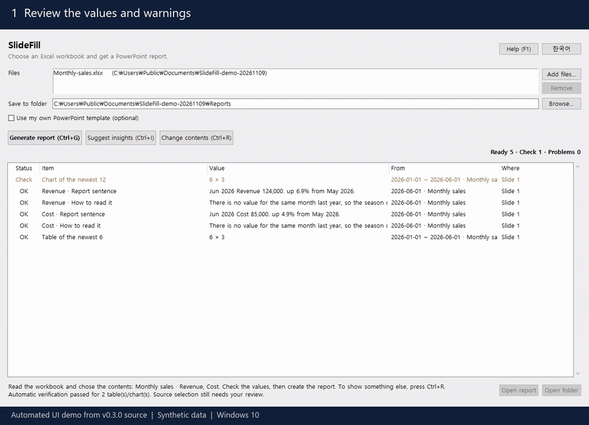

**English** | [한국어](README.ko.md)

# SlideFill

Choose an Excel workbook and get a PowerPoint report, or fill your own company template from it, so a weekly or monthly report takes one key press instead of an hour of copy and paste.

> [!IMPORTANT]
> **Review reports before sharing.** SlideFill uses explicit calculation rules and checks supported values and saved output. Optional AI suggests wording. A passed check does not certify source accuracy, business meaning or every Office layout.
>
> Confirm the selected sheets, measures, aggregation, periods, units and warnings, then inspect the final report. **Change contents (Ctrl+R)** adjusts workbook-only selections. Use a recalculated, saved workbook. [v0.4.0's reliability checks](doc/reliability-hardening.md) cover supported formula caches and numeric text and block saving when independent coverage is incomplete.

[](https://github.com/hobby-programmer-5000/slidefill/releases/download/v0.4.0/SlideFill-demo.mp4)

The demo uses synthetic data and a scripted UI session from the v0.4.0 source on Windows 10. PowerPoint renders the saved report on the host. [Watch the demo (MP4)](https://github.com/hobby-programmer-5000/slidefill/releases/download/v0.4.0/SlideFill-demo.mp4).

## Why I made this

Regular reports are the same slides with new numbers. Copying them by hand is slow, and it is how the wrong number ends up in front of your manager. SlideFill does the copying and shows you every value first.

## Features

- **A report from the workbook alone**: choose a file and SlideFill reads the sheet, chooses the contents, and shows the real values first. If it took the wrong figure, change it with Ctrl+R. This is an automatic judgement, so check the values before you create the report.
- **It asks when unsure**: if there are signs it chose wrongly, such as adding up values that look meaningless added, only counting rows, tables stacked on one sheet, a compared period with most of its values missing, a head count among per cents, many lines sharing one merged name, or a column left out for being the same on every line while a nameless line below holds its whole, it shows why and asks before making the report. If you keep the choice, the slide says the value was not confirmed. It will not catch every mistake.
- **It keeps what a value means**: levels such as heating values or concentrations are averaged, not added. Figures on a sheet whose stated unit is per cent are written in per cent and points. A period still running is not compared with others. Actuals beside a budget for the same year are read against the budget, and a statement's income and expense lines are not ranked against one another: its total lines are stated instead.
- **Text**: `{{Sales}}` or `{{Summary!B3}}` anywhere: text boxes, table cells, groups, notes, chart titles, slide masters. Your fonts and colors stay.
- **Tables**: fills a PowerPoint table from a range, adding or removing rows to fit. Total rows stay at the bottom.
- **Charts**: replaces chart data and keeps the chart's style. "Edit Data" in PowerPoint shows the new numbers.
- **Data that grows daily**: `{{latest:Daily!A,C}}` finds the newest date in column A, so the template never needs a new row number.
- **Figures worked out for you**: changes from last week's same weekday, the previous value and the recent mean, and a report sentence, all calculated by code with the compared dates shown.
- **Data as it really piles up**: several rows per date, periods across a row, several sheets, and shares and ranks for tables with no dates. No summary sheet needs making first.
- **Numbers as Excel shows them**: `85.3%`, `1,234,567원`, `2026년 11월 3일`. Checked against real Excel (see below).
- **Preview first**: a list of every value and where it comes from, before anything is created.
- **No silent blanks**: anything that cannot be filled stays as a visible `{{placeholder}}`, is listed as a problem, and the app asks before continuing.
- **Your files stay as they are**: the template and workbook are only read. Each report is a new dated file that never overwrites another.
- **Insight sentences you choose from** (optional): one sentence that says what a figure means, so whoever reads the report gets the point without working it out from the table. A model on your own PC reads the calculated results and suggests them. They pass checks, but nothing goes in the report until you pick it.
- **Runs locally**: SlideFill works on your PC without an account. The optional VBA check uses desktop Excel and insight suggestions talk only to Ollama on this PC. English and Korean.

## Accuracy and supported scope

SlideFill checks supported values and saved representations automatically, but does not certify that the source data is true, the selected measure answers your business question, or every input format and Office layout is correct. Review the sheet, period, unit, conditions and warnings before using a report.

v0.4.0 retains exact rational calculation intermediates, independently checks a bounded set of saved formulas and numeric text placeholders, and blocks saving for known mismatches or incomplete coverage. It reads the workbook's saved values. The optional Excel VBA check compares supported aggregates in desktop Excel. [Exact checks and scope](doc/reliability-hardening.md) · [Feedback, research and VBA experiments](doc/reliability-history.md).

See [feature-by-feature principles and formulas](doc/feature-algorithms.md), [automatic checks and what to do](doc/verification.md), [research methods and their limits](doc/research-methods.md), [supported layouts](doc/limits.md), and [code map and proof boundaries](doc/verification-design.md). These guides describe the source tree; check a downloaded executable's release notes for its included features.

## Install

Download `SlideFill.exe` from [Releases](https://github.com/hobby-programmer-5000/slidefill/releases) and run it. It is one portable file: no installer and no admin rights. Its settings are kept in `SlideFill.json` next to it, which appears the first time you pick a file, preview, or change the language.

The exe is not code-signed, so Windows SmartScreen may say "Windows protected your PC" the first time. Choose **More info → Run anyway**.

v0.4.0 was tested on Windows 10 using synthetic inputs and the installed desktop Office. The earlier clean Windows 10 VM test applies to v0.3.0. [Release notes](https://github.com/hobby-programmer-5000/slidefill/releases/tag/v0.4.0) · [Development and verification history](doc/development-history.md).

## Build from source

Windows 10/11 with [uv](https://docs.astral.sh/uv/):

```bat
uv venv --python 3.14 .venv
uv pip install --python .venv\Scripts\python.exe openpyxl python-pptx xlrd python-calamine pyinstaller
build.bat
```

`build.bat` runs the unit tests, builds `dist\SlideFill.exe`, then runs that exe on the sample files. Any failure stops it.

## Usage

### From workbook to report

1. **Choose your files.** Click **Add files…** or drop an Excel workbook into the window. If you have a `.pptx` template, enable **Use my own PowerPoint template (optional)** and select it.
2. **Check the preview.** Click **Preview (F5)**. Select a row to check its value and source, including the sheet, period and unit. Resolve any warnings and preview again after making changes.
3. **Compare with Excel if needed.** Click **VBA Check** to compare supported sums, means and counts in report tables and charts with desktop Excel. The report uses the exact Python values. See [Compare with Excel VBA](#compare-with-excel-vba).
4. **Review an insight draft if needed.** With Ollama running and the model installed, select a figure or an insight row and click **Suggest insights (Ctrl+I)**. For your own template, add an `insight` placeholder first. Select a sentence to see its calculated basis. To use it, click **Add to sentence**, review or edit it, and click **Use in report**. You can keep the calculated sentence.
5. **Generate and inspect the report.** Click **Generate report (Ctrl+G)** and then **Open report** to check the saved PowerPoint.

### Compare with Excel VBA

After choosing your input and any template, click **VBA Check**. It compares supported single-column sums, means, and counts in report tables and charts with the same operations in desktop Excel. The results distinguish exact equality, equality after rounding to a Double, and differences. Report generation uses the exact Python values.

This check requires desktop Excel with VBA on Windows. If Excel blocks the macro, use the app's prompt to open the included SlideFill workbook. If Excel offers **Enable Content**, allow it for that file, close it without saving, and retry. SlideFill opens only its own verified macro workbook in Excel. The [native VBA experiment](tools/vba/README.md) describes the original comparison and how to reproduce the bundled workbook.

### With a workbook alone

**1. Choose a workbook.** SlideFill reads it, chooses the contents, and lists the values that will go in. A large file can take a few minutes.

**2. Check the values.** The bottom of the window says which sheet and figure it took. To show something else, press **Ctrl+R** and change the sheet, figure or conditions.

**3. Press Ctrl+G.** A new `<workbook name>_<date>.pptx` appears beside the workbook. When your data changes, preview it again before creating the next report.

If there are signs it chose wrongly, it shows why and asks first. If you choose **Create it as it is**, the slide says the value was not confirmed.

**Insight sentences (optional):** select a figure in the list and press **Ctrl+I**. A model on this PC suggests sentences from the calculated results. The one you choose takes the place of that figure's "how to read it". If you choose none, the calculated sentence stays.

Each sheet gets one slide: sentences on the left, a chart and a table on the right. What goes in:

- Figures: up to 4 side by side all go in, such as domestic and foreign. With a total column, or 5 or more figures, only one goes in and the window says how many were left out.
- Sheets: up to 3 sheets built alike go in together. A sheet whose slide would say word for word what another's says, such as one by district whose province lines repeat the sheet by province, is left out and counted. More than that, such as one sheet per month, or sheets built differently are left out and counted.
- Units: the sheet name or a "unit" note above the table is copied onto the slide. A unit written anywhere else does not appear.
- Charts: a figure more than 10 times larger or smaller than the first goes in the table only.
- Tables: large numbers get commas. With your own template they stay as Excel shows them.
- Year columns: with columns such as `2025` and `2024`, only the newest goes in.
- Several header levels: a merged layout with the same complete sex/measure combinations under every period is read using one explicit combination, which the app asks you to confirm. Missing, duplicate or inconsistent combinations are not guessed at.

If your slides are already laid out, use a template as below.

**Several files.** Drag files onto the window, or press **Add files**, and the report opens with an overview: which way the figures moved across the files, calculated, then each file's main sentence, then each file's slide. Files that end at different times are not compared, and the slide says so. In **Ctrl+I**, "All the files together" asks the model for a sentence about them. How one file affects another is not in the data, so sentences that claim it are left out.

**With a Word document.** Add a `.docx` with your workbook and it gets its own slide. SlideFill finds entries that start with a date, matches the names in them to figures in the workbook, and shows the mean before and after that time in a table. That says the two came at the same time, not that one caused the other, and the slide says so. A document with no dated entries has its cautions and description quoted as they are, and its figures are looked for in the workbook. With several files, a document that shares a folder with only one workbook comes just before that workbook's slides. Word tables, pictures, `.doc` and `.hwp` are not read for this.

**Changing the contents.** **Ctrl+R** lists every sheet and figure. Tick what should go in and the slide it makes is drawn beside the list. Nothing in the report changes until you press **Use these contents**.

### With your own template

Tick **Use my own PowerPoint template** and a template field appears.

**1. Mark your template in PowerPoint.**

| You want | Where to type it | What to type |
|---|---|---|
| A value in text | In the text | `{{Sales}}` (a defined name in Excel) or `{{Summary!B3}}` |
| A table filled | Table's alt text | `{{table:Summary!A1:D10}}` or `{{table:SalesTable}}` |
| A chart filled | Chart's alt text | `{{chart:Summary!A1:D5}}` or `{{chart:TrendRange}}` |

Alt text: right-click the table or chart, then **View Alt Text**. The marker is removed from the finished report. Korean `{{표:...}}` and `{{차트:...}}` work too.

- Tables fill from the top-left cell, so include the header row. The column count must match.
- Charts read the first row as series names and the first column as categories.
- Bubble templates use an explicit X column followed by Y/size pairs; see [verification coverage](doc/verification.md).
- Prefer defined names or Excel tables. They keep working when rows move, and a table grows with new data.

For a sheet that gains a row every day, name the date column first and SlideFill finds the newest rows by date:

| You want | What to type |
|---|---|
| A value on the newest date | `{{latest:Daily!A,C}}` (column C, by the dates in column A) |
| The newest date | `{{latest:Daily!A}}` |
| The newest 7 rows in a table | Alt text: `{{table:latest7:Daily!A,C,D}}` |
| The newest 7 rows in a chart | Alt text: `{{chart:latest7:Daily!A,C,D}}` |

- Dates can be real Excel dates or text such as `2026/11/03`, `2026.11.03`, `2026년 11월 3일`, `20261103` and `2026-11`. Rows such as `소계` are skipped because they hold no date.
- Rows with no value yet, such as future dates filled in ahead, are skipped. If a newer row has values in other columns but not this one, the older value is used with a warning, because the report may then mix two days.
- If the newest date has several rows with different values, the placeholder stays and it is listed as a problem.
- Columns need not touch (`A,C,J`), and `A:D` means every column from A to D.
- A table keeps the header row in your template. If that row is blank, the header comes from the sheet. Chart series names always come from the sheet: the nearest filled cell above the first dated row.
- The list shows the date range used, so check it before you create the report. An old date means the workbook was not updated.

**You do not have to learn the notation.** Choose a workbook and press **Ctrl+R**: SlideFill reads how the sheet is laid out and shows references that work, with their real results. Copy one, or use **Save a starter template** to get a template with sentences, a table and a chart already in place. The first suggestion is an automatic judgement, so check that the figure and conditions are what you want. If not, change the sheet, figure or conditions in that window and it recalculates.

Other layouts work in any of the references here and below. Nothing is added up by guesswork: rows are only added when you write `sum`.

| Layout | Type this |
|---|---|
| Several rows per date | `{{latest:Daily!A,sum(D:E)}}`, `count(C)` for how many rows, `sum(D*E)` for quantity times price |
| Only some rows | `{{reading:Daily!A,sum(D, B=East)}}` (rows whose B is exactly East, or contains it if no cell is exact) |
| A mean, a share of rows | `mean(D)`, `rate(B=Yes)` (by date or by name) |
| Year and month in separate columns | `{{latest:Monthly!A+B,C}}` (year in A, month in B) |
| Periods across a row | `{{latest:Monthly!5,7}}` (periods in row 5, values in row 7) |
| Two tables on one sheet | `{{latest:Index!A10:A475,C10:C475}}` |
| One sheet per year | `{{reading:Sales*!A,C}}` (every sheet starting with Sales, joined) |

A table with no dates reads its first column as the names of items.

| You want | Type this |
|---|---|
| The largest and its share | `{{reading:Table!A,B}}` |
| What moved between two periods | `{{reading:Table!A,B,C}}` (B the earlier, C the later; a warning if the headings look the other way) |
| The largest item's name, value, share | `{{top1:Table!A,B}}`, `{{topvalue1:Table!A,B}}`, `{{share1:Table!A,B}}` |
| A table and chart of the top 5 | Alt text: `{{table:share5:Table!A,B}}`, `{{chart:top5:Table!A,B}}` |

With no total on the sheet, sentences say "the items' sum" rather than "the total", with a warning. Whether figures can be added at all, unlike an index or a mean, is judged from headings and the sheet's name, so do read that warning. A table numbered by level, such as `I.`, `1.`, `(1)`, compares only its top level.

Warnings stay in the app's list and are not printed on the slide. So when a figure must be read differently (a period not fully counted, values after a gap, a day cut short), `note` and `reading` say so in the sentence itself. A single figure such as `prev` has no room for that, so check its warning.

SlideFill can also work out figures from a date column and one value column. These go in text:

| You want | What to type |
|---|---|
| Change from the same weekday last week | `{{week:Daily!A,C}}` |
| Change from the previous value | `{{prev:Daily!A,C}}` |
| Change from the mean of the previous 7 values | `{{avg7:Daily!A,C}}` (the newest value is not part of its own mean) |
| The date of the highest or lowest of the newest 30 | `{{peak30:Daily!A,C}}`, `{{low30:Daily!A,C}}` |
| A report sentence with these figures | `{{note:Daily!A,C}}` |
| How to read the figure | `{{reading:Daily!A,C}}` |

`reading` needs no model and no GPU. Fixed rules decide, so the same data always reads the same. They say when a comparison misleads (a weekend inside a mean, a Monday against a Sunday, last week's same day being a holiday, a month against a low month before it, part of a year against whole years), when a value is outside its weekday's usual range, and when one recent day moved the mean, and by how much. Monthly and quarterly data read by the same period last year first. They never state a cause. They only say what to check.

If there is no value to compare with, such as no row exactly seven days earlier, or a base of 0, the placeholder stays and is listed as a problem. The list shows which dates were compared.

For a sentence that reads the figures, type `{{insight:Daily!A,C}}` in text, then press **Ctrl+I**:

1. SlideFill works out the figures, and finds points worth noticing, such as comparisons that point different ways.
2. It counts the Korean and English letters in your template, gives each sheet name and each cell of words near the top of each sheet one vote, and picks the model for that language. Sheets named `Question1` over Korean answers are Korean.
3. The model writes candidates from those results. It is never asked to calculate.
4. Checks leave out sentences with numbers their cited facts do not hold, stated causes, and known misreadings.
5. You read the rest against their basis, then add and edit what you want.

Until you choose, the report uses the calculated sentence and the list says so. When the figures change, a sentence chosen for the old ones is not reused. **In an earlier evaluation, about 1 in 6 Korean sentences from the best model tested was wrong. Review each draft against its calculated basis before using it.**

This step needs [Ollama](https://ollama.com) with up to 8GB of video memory. Everything else works without it. To set it up:

```bat
ollama pull hf.co/mykor/A.X-4.0-Light-gguf:Q4_K_M
ollama pull qwen3.5:4b
```

**2. Choose the template and workbook.** The list shows what will go where. Press F5 to refresh it.

**3. Press Ctrl+G.** The app remembers your files. Preview them again when you update your data or template.

Try it with `samples/sample_template.pptx` and `samples/sample_data.xlsx`.

### Good to know

- SlideFill reads the values Excel last **saved**. Save the workbook first.
- Files with a password or document security (DRM) cannot be read. It tells you so.
- Reads `.xlsx .xlsm .xltx .xltm .xls .xlsb .ods .csv .tsv .txt`. Macros never run. A file named `.xls` that is really an HTML table or an `.xlsx` is read too.
- `.xlsb` and `.ods` keep their number formats and merged cells, read from the file's own records, so 85% stays 85%. An `.xls` that is really an HTML table keeps cells that span rows or columns, as Excel lays them out.
- `.ppt` is not supported.
- Hidden sheets are left out of the automatic choice, and read only when no other sheet holds figures. A sheet named as a forecast, plan or budget is not joined to the actuals.
- The automatic choice takes a sheet named as a summary (요약, 총괄, 종합, summary) first, then the one with the newest year in its name. A log with only words and dates, such as a list of complaints, is read as a count by date, after any sheet that holds numbers (such as one tallying survey answers).
- `△500`, `(300)` and `(1,234)` read as negatives. `(1)`, `(2)` under the headings number the columns and are not figures. Digits it cannot read, such as `▲500` or `1,2,3` with commas that do not group thousands, are left out, so it asks first.
- A table beyond an empty column, or another table under a blank row, is not mixed in. Of tables stacked on one sheet only the first is read, and it asks first, as it does when rows may have been left out because a sum matched by chance.
- Placeholders inside SmartArt are filled. PowerPoint then lays the SmartArt out again when it opens the report, so a long value fits its box. A SmartArt saved in a shape SlideFill cannot read is reported, with the slide it is on.
- A number format's colour, such as `[Red]` for a loss, carries to the slide: only the value is coloured, in text and in tables. A calculated dated sentence also colours its current value when it comes directly from one source cell. Other words, aggregates, comparisons and model sentences keep the template's colour. `[Black]` and `[White]` keep it too.
- A table's heading rows can be merged down and it still grows and shrinks. With merges in the body, match the row count. A table that would grow over a shape below it gets a warning.
- Dynamic names built from `OFFSET`, `INDEX`, `COUNTA`, `COUNT`, `ROWS` and `COLUMNS` are worked out to the cells they cover, so a name that grows with its data is read. A name holding any other formula is reported.
- A financial year (`2025-26`, `Q1 FY24`) ends when the workbook says it does, in words such as `year ending 31 March`, `July to June`, `4월~3월` or `3월 결산`. If the end is missing or conflicting, the report says so and shows the current value without deciding completion or comparing periods. Add the year end to the workbook and preview again; an explicit change placeholder stays unresolved until then.
- Charts read numeric text, including `23,109` and `(500)`, with the same rules as calculations and report that conversion. Unreadable text and booleans remain gaps with warnings.
- Annual sheets named only `2025`, `2024`, etc. retain that year on every generated slide. A single unit note above a wide table is found even at its right edge.
- Unusual number formats (fractions, `[DBNum1]` and the like) fall back to the plain value with a warning. Conditions such as `[>=5]#,##0` show as Excel shows them.
- Numbers are written with `,` for thousands and `.` for decimals on every PC. Excel follows the PC's region, so on a PC set to German it shows `1.234,5` where the slide says `1,234.5`. This is on purpose: the sentences SlideFill writes use the same marks, and a report should read the same whichever PC made it. Text such as `1.234,5` typed into a cell is not read as a number, so it asks first. Spaces that group thousands, as in `39 925`, are read.

## How it is checked

| Claim | Check |
|---|---|
| Numbers match Excel | `tools/compare_with_excel.py` has real Excel display over 100 values and formats, then compares every one |
| Reports open cleanly | `tools/verify_powerpoint.ps1` opens a report in real PowerPoint and opens each chart's data |
| SmartArt shows its values | `tools/smartart_check.ps1` has real PowerPoint draw a SmartArt with placeholders, then reads the filled report's SmartArt back and saves pictures of it |
| The window works | `tools/gui_check.py` runs the shortcuts and dialogs; `tools/gui_check.ps1` starts the real exe |
| Everything else | `test_core.py`, which `build.bat` runs every time |
| Reading rules fire on the right days | Run on every day of real public data, 2022 to 2025. See [how it works](doc/how-it-works.md) |

The Excel and PowerPoint checks need Office installed, and the format comparison reflects the regional settings of the PC running it. More detail: [how it works](doc/how-it-works.md).

See [supported layouts and remaining verification](doc/limits.md). Public-file regression checks do not establish compatibility with your company's files or replace a person's trial of the executable.

Automatic CPU verification runs during preview and saving for filled tables, category/date/XY charts, supported numeric text and formula caches. It blocks saving if coverage is incomplete. [Verification guide](doc/verification.md).

## Project layout

```
app.py              window
contents.py         the window for changing contents, and dropping files
readers.py          reads .xls, .xlsb, .ods, .csv and more into one form
documents.py        reads Word files and lines their dated entries up with figures
core.py             reads the workbook, fills the template (no GUI, no model)
suggest.py          chooses report contents and builds starter slides
layouts.py          bounded rate/organization tables and source warnings
verification/       automatic checks, independent oracles, proved kernel, tests
facts.py            calculated figures and the language router
insight.py          candidate sentences from the local model, and their checks
numfmt.py           renders values the way Excel displays them
i18n.py             English and Korean text
test_core.py        unit tests
build.bat           tests, build, smoke test
tools/              real-Office checks, samples, notices
samples/            made-up example files
```

## Contributors

- [@hobby-programmer-5000](https://github.com/hobby-programmer-5000): idea, requirements, testing
- **Claude** (Anthropic): design and implementation, pair-programmed in [Claude Code](https://claude.com/claude-code)
- **Codex** (OpenAI) contributed from the eighth v0.2.0 measurement through v0.4.0, including measurement, regression fixes, CPU verification, native Excel experiments, Windows and Office testing, documentation and release preparation. [Work history](doc/development-history.md).

## License

[MIT](LICENSE). Bundled components keep their own licenses, listed in [THIRD-PARTY-NOTICES.md](THIRD-PARTY-NOTICES.md).
