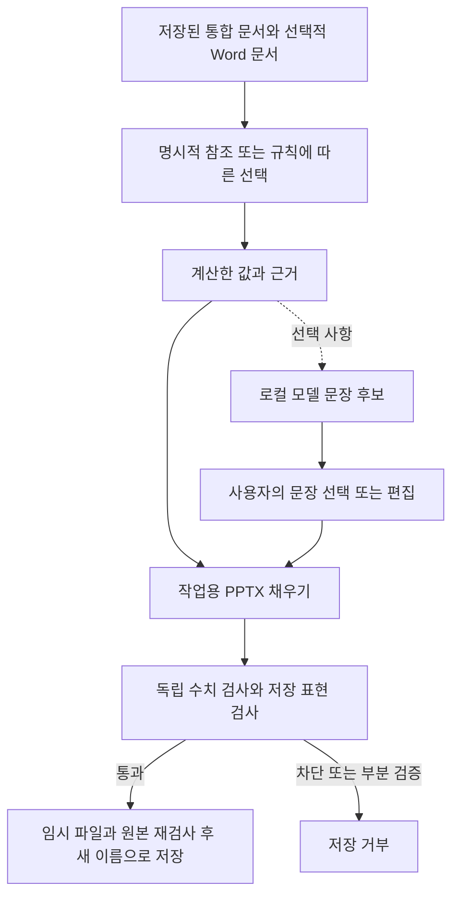

[English](feature-algorithms.md) | **한국어**

# 기능별 동작 원리·수식·알고리즘

개발 소스 `d58471b`를 기준으로 기능마다 입력, 처리 규칙, 수식과 한계를 정리한 문서입니다. 여기서 설명하는 수치 신뢰성 개선은 **미출시 상태**이며 공개한 v0.3.0 EXE에는 포함되지 않습니다. 구현을 설명하는 문서이며 새 동작이나 새로운 정확도 측정 결과를 추가하지 않습니다.

산술 계산, 원본 선택, 해석 규칙, 선택적 모델 문장은 보장 범위가 다릅니다. 정확한 산술은 지정한 계산의 답을 구합니다. 선택한 지표·원본·업무 정의가 적절했는지까지 결정하지는 못합니다.

## 기능 찾아보기

| 동작·기능 | 처리 방식 | 설명 |
|---|---|---|
| 파일 추가·드롭, 언어 변경, 다시 실행 | 파일 구분과 로컬 설정 | [1](#input), [14](#controls) |
| 엑셀만으로 보고서 / 내용 바꾸기 | 규칙에 따른 선택, 명시적 참조, 계산한 미리보기 | [2](#selection) |
| 기존 템플릿 / 참조 추천 | 셀·이름 해석과 실제 계산한 제안 | [3](#references) |
| 최신값·조건·집계 | 날짜 정렬과 명시한 행 연산 | [4](#latest), [5](#aggregates) |
| 증감·평균 대비·최고/최저일 | 정해진 산술과 관측값 창 | [6](#changes) |
| 순위·구성비·예산 대비 | 항목·합계 선택과 비교 규칙 | [7](#items) |
| 계산한 보고 문장 / 읽는 법 | 모델을 쓰지 않는 고정 해석 규칙 | [8](#readings) |
| 지원하는 구조화 표 | 제한된 표 문법 인식 | [9](#structures) |
| 여러 통합 문서 / Word 맥락 | 비교 가능한 방향 판단, 날짜 전후 구간 | [10](#cross-file), [11](#word) |
| 통찰 문장 제안(Ctrl+I) | 계산한 후보, 선택적 로컬 모델, 사용자 선택 | [12](#insights) |
| 텍스트·표·차트·숫자 모양 | 서식 해석과 PPTX 기록 | [1](#input), [13](#writing) |
| 미리보기(F5)·생성(Ctrl+G) | 같은 채우기 경로, 독립 수치 검사, 임시 파일 재검사 | [14](#controls) |



그림의 검사는 지원하는 수치 계약에 대한 것입니다. 모든 문장이나 화면 배치를 증명하지 않습니다. 업무 선택에 대한 의심, 일반 자리표시자 문제, 수치 검증 상태는 서로 다른 판단입니다.

## 기호와 정밀도

- `x_1 ... x_n`: 선택한 조건·집계 후 날짜순으로 남은 숫자 관측값입니다. `d_i`는 `x_i`의 날짜입니다.
- `b`: 비교 기준값, `N`: 관측값 개수입니다. 누락값을 자동으로 0으로 취급하지 않습니다.
- 주요 합·곱·평균·증감 계산은 중간값을 유리수로 유지합니다. `Fraction(str(decoded_value))`는 입력 디코더가 제공한 값의 십진 표기를 보존합니다. 디코딩 전에 잃은 자릿수를 되살리지는 못합니다.
- 일부 선택·문장·비교 가능성 경로에는 실수나 이미 표시한 숫자도 쓰입니다. 이들은 테스트한 규칙이며 앱의 모든 분기가 정확한 유리수 연산이라는 증명은 아닙니다.
- 서식은 계산과 별도 연산입니다. `General`은 표시 자릿수를 제한하므로 내부 값이 맞더라도 원본의 모든 자릿수가 화면에 나오지는 않을 수 있습니다.

<a id="input"></a>
## 1. 파일 읽기와 숫자 표시

**입력:** XLSX/XLSM/XLTX/XLTM, XLS/XLSB/ODS, CSV/TSV/TXT이며 DOCX는 선택적 맥락 자료입니다. 템플릿·출력은 PPTX입니다. PDF/OCR 입력 기능은 없습니다. 매크로나 `=`로 시작하는 CSV 문자열을 실행하지 않습니다.

XLSX 계열은 openpyxl로 저장된 값을 읽습니다. XLS는 xlrd, XLSB/ODS는 calamine과 별도의 서식·병합·시간·오류 처리를 사용합니다. `.xls` 확장자는 실제 내용도 확인합니다. XLSX·HTML 표·구분자로 나눈 텍스트일 수 있기 때문입니다. 텍스트 입력은 BOM·인코딩 검사와 파일 앞부분의 구분자 개수로 해석합니다. 언어 모델의 추론이 아닙니다. `007`처럼 앞에 0이 있는 코드는 텍스트로 유지합니다.

계산용 숫자 해석에는 올바른 천 단위 묶음, 지원하는 단위 접미사, `△500`·`−500`·`(1,234)` 같은 음수가 포함됩니다. 짧은 `(1)`은 음수로 취급하지 않습니다. 텍스트 `78.5%`, 잘못 묶은 `1,2,3`, 읽을 수 없는 값, 유한하지 않은 수를 조용히 계산용 숫자로 바꾸지 않습니다. 원래 숫자 셀인지, 텍스트를 숫자로 읽었는지는 경고로 구분합니다.

숫자 서식기는 양수·음수·0 구역, 조건, 문자, 날짜, 과학 표기, 백분율·천 단위 축소를 해석합니다. 백분율 기호가 p개, 뒤쪽 축소 쉼표가 s개이면 다음과 같습니다.

```text
표시용 숫자 크기 = x * 100^p / 1000^s
```

소수 k자리(`k >= 0`)를 표시하는 지원 서식에서 `x = n/d`이면 반올림은 다음과 같습니다.

```text
a = abs(n) * 10^k
q = floor(a / d)
2*(a - q*d) >= d이면 z = q + 1, 아니면 z = q
반올림 결과 = sign(n) * z / 10^k
```

정확히 절반이면 0에서 멀어집니다. 두 자리에서 `2.675 → 2.68`, `-2.675 → -2.68`입니다. 표시 규칙이므로 이후 계산에는 반올림 전 유리수를 계속 쓸 수 있습니다. 구조화 표의 십진수 합도 공통 십진 자릿수로 정수화한 뒤 생성된 정수 합 연산을 사용합니다.

`General`은 `10^15` 미만의 정수를 그대로 표시하고, 그 이상이나 `0 < abs(x) < 10^-4`에서는 과학 표기를 사용합니다. 나머지는 제한된 유효 자릿수(절댓값 1 미만 9자리, 그 외 10자리)를 씁니다. 미지원 서식은 기본 표기로 돌아가며 경고합니다. 지역별 날짜 구분자·기본 서식과 지원하는 숫자 색은 별도로 처리합니다. 숫자의 천 단위 구분자는 쉼표, 소수점은 마침표입니다. 완전한 Excel 렌더러는 아닙니다.

코드: [load](../readers.py#L609), [_text_cell](../readers.py#L61), [as_number](../core.py#L423), [figure_number](../core.py#L497), [format_value](../numfmt.py#L81), [_general](../numfmt.py#L501), [round_rational](../verification/kernel.py#L58). 테스트: [Formats](../test_core.py#L44), [ExactReadings](../verification/test_reliability.py#L20).

<a id="selection"></a>
## 2. 엑셀만으로 보고서 만들기와 내용 바꾸기

**동작:** 회사 템플릿 없이 파일을 고르고, **내용 바꾸기(Ctrl+R)**에서 통합 문서용 선택을 바꿉니다.

선택기는 셀을 표본 검사해 날짜·항목명·수치·합계·반복 구조를 찾습니다. 프로필 기본 범위는 최대 3,000행·60열·제목 25행입니다. 자료 사전, 목차, 식별 코드, 설치 연도 같은 속성 날짜를 제외하려고 시도합니다. 이름과 셀 패턴을 쓰므로 업무상 잘못된 선택을 할 수 있습니다.

후보 시트는 보이는 자료 시트를 우선하고, 보이는 후보가 없을 때만 숨긴 시트를 고려합니다. 숫자 시트가 날짜만 있는 기록보다, 실적이 계획·예측보다 먼저입니다. 요약·이름에 있는 최신 연도 등을 우선한 뒤 활성 시트·통합 문서 순서로 정합니다.

적절하면 명시한 합계 지표와 최신 기간까지 이어지는 지표를 우선합니다. 반복된 가산 수치는 `sum`, 수준·비율·단가는 `mean`, 사건 기록은 `count`를 고를 수 있습니다. 조건으로 전체 행만 골라 합계와 부분을 이중 합산하지 않기도 합니다. 선택은 명시적 참조 문자열로 바뀌고, 제안하기 전에 core 경로에서 **실제로 계산**합니다.

일반 시계열 제안에는 최신값, 계산한 해설·읽는 법, 비교값·최고/최저일, 최신 6개 표·12개 차트가 포함됩니다. 관련 지표 2–4개는 함께 보여줄 수 있습니다. 규모가 크게 다른 값은 자동으로 같은 축에 놓지 않으며 비교에는 10배 기준을 씁니다. 호환되는 일부 시트도 포함할 수 있지만 크거나 서로 다른 시트 묶음을 전부 넣으라는 뜻으로 해석하지는 않습니다. 지원하는 구조화 표가 있으면 일반 시계열·항목 처리보다 우선합니다.

화면 아래·상태 정보에는 선택한 내용과 제외한 개수가 나옵니다. 건수만 센 선택, 가중치 없이 평균한 비율, 혼합 단위, 빠진 날짜, 추정한 상하위 합계, 모호한 병합 이름 등이 의심 신호입니다. 이대로 유지하면 해당 선택의 미확인 조건을 보고서에 덧붙입니다. 업무 의미가 수학적으로 확정되는 것은 아닙니다. 선택을 바꾸면 참조와 결과를 다시 계산합니다.

회사 템플릿 모드의 Ctrl+R은 첫 통합 문서에 대한 **참조 추천**입니다. 임의 템플릿의 모든 자리표시자를 자동으로 다시 연결하는 기능은 아닙니다. GUI의 회사 템플릿 경로는 첫 통합 문서를 사용하며, 여러 파일 자동 보고서와는 경로가 다릅니다.

코드: [data_sheets](../suggest.py#L270), [read_shape](../suggest.py#L875), [default_value](../suggest.py#L935), [default_how](../suggest.py#L962), [default_conditions](../suggest.py#L1089), [find_doubts](../suggest.py#L1292), [plan_report](../suggest.py#L1701), [App.open_helper](../app.py#L818). 테스트: [Suggestions](../test_core.py#L1531), [ReportReliability.test_rate_mean_requires_explicit_scope_review](../verification/test_reliability.py#L201).

<a id="references"></a>
## 3. 셀·정의 이름과 기존 템플릿 참조

**텍스트 예:** `{{Sales}}`, `{{Summary!B3}}`. **도형 표시:** 표·차트의 대체 텍스트 설명에 `{{table:Summary!A1:C5}}`, `{{chart:Summary!A1:C5}}`를 넣습니다. 표시 종류와 실제 도형 종류가 같아야 합니다.

명시한 셀·영역, 대소문자를 구분하지 않는 정의 이름(통합 문서 범위 다음 워크시트 범위), Excel 이름 있는 표를 찾습니다. 따옴표로 감싼 시트명과 `$` 절대 주소도 정규화합니다. 지원하는 계산 문구 기능이 아니라면 텍스트 자리표시자는 셀 하나로 결정되어야 합니다.

동적 이름 영역에는 별도의 제한된 해석기가 있습니다. `OFFSET`, `INDEX`, `COUNTA`, `COUNT`, `ROWS`, `COLUMNS`, 정수 `+/-`, 셀 영역만 지원합니다. 예를 들어 `OFFSET(Sheet!$B$1,COUNTA(Sheet!$B:$B)-1,0)`로 마지막 채워진 행을 선택할 수 있습니다. 14절의 독립 저장 수식 검사기와는 문법이 다릅니다. 지원하는 셀 영역으로 정할 수 없는 이름 수식은 임의 Excel 코드로 실행하지 않고 문제로 표시합니다. 최종 동적 영역은 200열·1,048,576행 이내입니다. 전체 셀 수가 백만 개 이하라는 뜻은 아닙니다.

코드: [ExcelSource.locate](../core.py#L1451), [_dynamic_area](../core.py#L762), [_Run.fill_marked_shape](../core.py#L3392). 테스트: [TextFill](../test_core.py#L260), [TableFill](../test_core.py#L329), [ChartFill](../test_core.py#L460).

<a id="latest"></a>
## 4. 최신값과 날짜 선택

`{{latest:Daily!A,C}}`는 A를 날짜, C를 값으로 사용합니다. `latest6`은 표·차트용 최신 유효 행 6개를 돌려주며, 텍스트에서는 보통 값 하나를 요청합니다. 행 번호는 가로 방향 자료(`Sheet!5,7`), 제한 영역은 한 표, `A+B` 또는 `A+B+C`는 분리된 연·월[/일]을 나타냅니다. 시트 이름 와일드카드로 명시한 시계열을 연결할 수도 있습니다.

실제 날짜·지원하는 날짜 문자열과 후보 값을 읽고, 시트 위치가 아닌 날짜로 정렬합니다. 미래의 빈 행·텍스트만 있는 행을 조용히 최신 숫자로 삼지 않습니다. 원본 오류나 저장 결과가 없는 수식은 문제로 남깁니다. 최신 후보 값이 충돌하면 모호하다고 판단하고, 숫자 비교 시계열의 중복 날짜는 거부합니다. 그룹 시계열에서는 같은 날짜가 여러 시트에 겹치는 경우도 거부합니다.

연도만 있는 값은 연도가 우세한 날짜 줄에서 해석합니다. 연도 없는 월은 명시한 제목·시트 맥락이 타당하면 그 연도를 사용합니다. 없으면 내부 정렬용 연도 2001을 쓰되 원본이 2001년 자료라고 말하지 않습니다. 회계연도 표기는 유지합니다. 회계연도 종료월이 없거나 충돌하면 기간 완료·기간 비교 판단을 유보합니다.

주기는 최신 최대 31개 관측값의 일 단위 날짜 간격을 정렬한 뒤 `gaps[floor(length/2)]`로 추정합니다. 간격 수가 짝수이면 가운데 둘 중 큰 것을 택합니다. 일별=1일, 월별=28–31일, 분기별=89–92일이며 연별에는 365/366일과 지원하는 연간·부분연도 패턴이 포함됩니다. 리샘플링·보간·누락 날짜 자동 채우기는 하지 않습니다.

완료 여부는 통합 문서의 저장 수정일과 오늘 중 이른 날을 기준으로 하고, 저장일을 구할 수 없으면 오늘을 씁니다. 주기와 회계연도 근거에 따라 기간 끝을 판단합니다. 기준일 당일의 일별 값은 해당 요일의 과거 수준보다 15% 이상 낮을 때에만 미완료 경고를 냅니다. 원본 최신성·완전성을 증명하는 검사는 아닙니다.

코드: [ExcelSource._parse_ref](../core.py#L1576), [ExcelSource._latest_rows](../core.py#L1750), [ExcelSource._plain_series](../core.py#L2040), [ExcelSource._as_of](../core.py#L1816), [ExcelSource._period_issues](../core.py#L1821), [_usual_gap](../facts.py#L236), [unfinished](../facts.py#L355). 테스트: [Latest](../test_core.py#L543), [DataShapes](../test_core.py#L1051), [ReportReliability.test_stale_unselected_date_cannot_hide_the_actual_latest_period](../verification/test_reliability.py#L171).

<a id="aggregates"></a>
## 5. 조건·합계·곱·건수·평균

**참조 예:** `latest:Daily!A,sum(C, B=North)`. 먼저 조건에 맞는 행을 남기고 행별 기여값 `u_i`를 만든 다음, 날짜의 일 단위 또는 항목명으로 묶습니다.

| 식 | 행별 기여값·그룹 결과 |
|---|---|
| `sum(B:C)` | 각 행에서 읽을 수 있는 선택 셀을 더해 `u_i`를 만들고 `sum(u_i)`를 구합니다. 읽을 수 있는 선택 숫자가 하나도 없는 행은 기여하지 않습니다. |
| `mean(B:C)` | 같은 행별 합을 만든 뒤 `sum(u_i)/m`을 구합니다. m은 기여한 **행 수**이며 전체 숫자 셀 수가 아닙니다. |
| `sum(B*C)` / `mean(B*C)` | 모든 인수를 곱해 `u_i`를 만듭니다. 인수가 누락되거나 읽히지 않으면 그 행을 제외한 뒤 곱들을 합산·평균합니다. |
| `count(B:C)` | 선택 셀 중 하나라도 비어 있지 않은 행을 셉니다. 텍스트도 포함하며 Excel 수식 `COUNT`의 숫자 셀 개수와 다릅니다. |
| `rate(B=Done)` | 다른 조건을 통과한 비어 있지 않은 B 기록에서 일치하면 1, 아니면 0을 평균합니다. 빈 B는 분모에서 제외합니다. |

0은 실제 피연산자이며 평균의 분모에도 포함됩니다. 누락값을 0으로 바꾸지 않습니다. 두 행이 `(B,C)=(2,3),(4,빈칸)`이면 행별 합은 5와 4이므로 `sum(B:C)=9`, `mean(B:C)=4.5`입니다. 완전한 곱은 6이고 인수가 빠진 두 번째 행의 곱은 제외합니다.

조건은 대소문자를 구분하지 않고 지원하는 연도 표기를 정규화합니다. 요청한 단어가 도메인에 정확히 있으면 일치 비교를 하고, 정확히 없으면 부분 문자열 비교를 할 수 있습니다. 병합 셀의 원점도 사용합니다. 따라서 `B=North`가 항상 SQL의 문자열 완전 일치와 같은 뜻은 아닙니다.

명시적으로 묶는 시계열에서는 한 날짜가 뒤따르는 빈 날짜 행을 덮다가, 다음 날짜나 Total 같은 비어 있지 않은 비날짜 경계에서 끝납니다. 병합 날짜 아래 행을 조용히 합산하지 않는 일반 최신 범위와는 다릅니다. 합계·소계·겹친 시트에는 각각의 선택 규칙을 적용해야 이중 계산을 피할 수 있습니다.

**비율 정의가 중요합니다.** `100/100`, `0/900` 두 행의 동일 가중 평균은 `(1+0)/2=50%`지만 전체 비율은 `(100+0)/(100+900)=10%`입니다. `mean`이나 기록 비중 `rate`가 가중치를 만들어내지는 않습니다. 전체 비율이 필요하면 분자·분모를 명시하세요. 예를 들어 지원하는 원본 수식 `SUM(C2:C3)/SUM(D2:D3)`를 사용할 수 있습니다. 자동 선택한 비율 평균에는 범위 확인 의심 신호가 붙습니다.

코드: [_matches](../core.py#L1242), [_aggregate_value](../core.py#L1254), [ExcelSource._summed_series](../core.py#L2112), [value_spec](../suggest.py#L1140). 테스트: [DataShapes](../test_core.py#L1051), [Remaining.test_randomized_group_sums_products_means_and_filtered_values](../verification/test_remaining.py#L166), [ReportReliability.test_rate_mean_requires_explicit_scope_review](../verification/test_reliability.py#L201).

<a id="changes"></a>
## 6. 증감·평균 대비·최고/최저일

양적 수치의 상대 변화는 `r=(x_n-b)/abs(b)`이고 백분율 표시는 `100*r`입니다. 기준값이 0이면 상대 변화를 유보합니다. `100→120`은 `+20.0%`이고 이 규칙에서 `-100→-50`은 `+50.0%`입니다. 항목별 문장에는 음수 기준에 대한 추가 제한이 있습니다(7절).

비율·점수는 차이 `points=(x_n-b)*s`를 씁니다. 소수로 저장한 백분율 셀은 `s=100`, 이미 포인트인 값은 `s=1`입니다. 단순 증감량 열은 양적 차이를 표시합니다. 백분율 서식의 `0.82→0.85`는 `+3.0포인트`이며 상대적으로 3% 증가했다는 뜻이 아닙니다.

| 자리표시자 | 기준·창·반환값 |
|---|---|
| `prev` / `직전대비` / `전일대비` | 직전 유효 관측값입니다. 반드시 어제인 것은 아닙니다. |
| `week` / `전주대비` | `d_n - 정확히 7일`인 관측값입니다. 가장 가까운 날로 대체하지 않습니다. |
| `avgN` / `평균대비N` | `b=(x_(n-N)+...+x_(n-1))/N`이며 기본 N=7입니다. 최신값을 빼고 N개의 선행 관측값이 없으면 유보합니다. |
| `peakN` / `lowN` | 현재를 포함한 최신 N개 중 최대·최소이며 기본 N=30입니다. 동률이면 가장 최근 것을 고릅니다. 숫자가 아닌 **원본 날짜의 표시 문자열**을 반환합니다. |

N에는 양수를 사용합니다. 직전 값이 100·110·120이면 평균 기준은 110이고, 최신값 130은 그 기준 대비 `+18.2%`입니다. 창은 유효 관측값 개수이며 연속된 N일이라는 뜻이 아닙니다. 비교 기준이 없으면 자리표시자와 문제 표시가 남습니다. 작은 변화의 “변동 없음”은 실제 소수 한 자리 백분율 표시를 따릅니다. 절반 경계가 `0.1%`로 표시되면 변동 없다고 부르지 않습니다.

코드: [ratio](../facts.py#L120), [points_text](../facts.py#L152), [previous](../facts.py#L173), [week_ago](../facts.py#L177), [mean_before](../facts.py#L183), [extreme](../facts.py#L189), [ExcelSource._calc_text](../core.py#L2291). 테스트: [Figures](../test_core.py#L746), [Calculations](../test_core.py#L865), [ReportReliability.test_numeric_calculation_text_is_independently_recomputed](../verification/test_reliability.py#L92).

<a id="items"></a>
## 7. 항목 순위·구성비·짝지은 지표

텍스트의 `topN`, `topvalueN`, `shareN`은 N위(기본 1위)를 고릅니다. 표·차트 표시에서는 상위 N개 행(기본 5개)을 요청하고 `share`는 구성비 열을 추가합니다. 이름 있는 항목은 값 내림차순이지만 Other/기타는 마지막에 둡니다. 정렬 키가 같으면 원본 순서를 유지합니다. 이와 별도로 최신 시계열 값의 순위는 최신 30개에서 `1 + 현재보다 큰 값의 개수`이므로 동률은 같은 순위입니다.

합산 가능한 지표에서 `구성비_i=x_i/T`입니다. 원본에 적힌 합계 T가 `abs(T-sum(x_i)) <= 0.005*abs(T)`이면 같은 전체로 인정합니다. 합계가 맞지 않으면 구성비를 유보합니다. 원본 합계가 없을 때는 “항목의 합”이라고 한정하며 원본이 전체를 명시한 것처럼 말하지 않습니다. 비율·평균·단가·음수 항목·개요·겹치는 합계에는 추가 적격성 규칙이 있습니다. 제목 하나만 보고 회계 항등식을 확정하지 않습니다.

인식한 명시적 합계·소계·상하위 수준은 항목 합에서 제외합니다. 추정한 부모·자식 합에는 0.1% 허용량과 다른 보호 조건(국소 합 추정에서는 부모 크기 최소 100 등)을 적용합니다. 원본에 구조 표시가 없는 합 추정은 우연히 같을 수 있어 의심 신호를 냅니다. 수입·지출처럼 서로 다른 합계는 각각 말합니다.

짝지은 지표도 같은 증감 계산을 쓰지만 상대 성장 문장에는 양수 기준을 요구하고, 큰 변화를 고를 때 매우 작은 항목을 제외합니다(최대 항목의 1% 기준). 절대 기여와 최대 상대 성장률은 다른 값입니다. 음수 기준은 실제 전→후 값으로 표시합니다. 같은 기간의 실적·예산/목표는 계획 대비로 말하며 과거 대비 성장이나 자동 좋음·나쁨 판정을 하지 않습니다.

코드: [rank](../facts.py#L223), [ranked_items](../facts.py#L721), [is_additive](../facts.py#L736), [without_parts](../facts.py#L804), [item_readings](../facts.py#L867), [ExcelSource._read_comparison](../core.py#L2354), [ExcelSource._rank_text](../core.py#L2557), [ExcelSource._rank_range](../core.py#L2580). 테스트: [DataShapes](../test_core.py#L1051), [AutomaticGuard.test_split_dates_and_share_denominators_are_source_checked](../verification/test_automatic.py#L208).

<a id="readings"></a>
## 8. 계산한 해설·읽는 법: 계절·이상 징후 규칙

`note`는 계산한 보고 문장, `reading`은 읽을 때 참고할 관찰을 만듭니다. 둘 다 모델을 호출하지 않습니다. 규칙에 따라 제한된 관찰(보통 최대 3개)을 고르며 자유로운 통계 분석은 아닙니다. 여러 조건이 맞으면 규칙 우선순위도 결과에 영향을 줍니다.

최신 요일과 같은 요일의 이전 값 W를 최대 8개, 최소 3개 모아 다음을 구합니다.

```text
L = median(W)
MAD = median(abs(w-L))
S = max(1.4826*MAD, 0.01*abs(L))
```

유효한 산포가 없으면 평소 범위 결과를 만들지 않습니다. 계수·임계값은 해석 정책이며 학습한 확률 모델이나 신뢰구간이 아닙니다.

| 규칙 | 주요 조건·연산 |
|---|---|
| 일별 평소 범위 밖 | `abs(x-L)/S >= 3`이면서 상대 이탈이 7% 이상입니다. |
| 과거의 특이 관측값 | 산포 3배·상대 이탈 15% 이상입니다. 최신 7개 중 절대 상대 이탈이 가장 큰 것을 고릅니다. |
| 한 값이 평균을 움직임 | 그 값을 뺀 가상 비교에서 백분율 결과가 2%포인트 이상 달라집니다. 원래 보고서 값을 삭제·대체하지 않습니다. |
| 평일·주말 효과 | 최신 28개 중 평일 값과 주말 값 2개 이상이 있어야 합니다. 평균 차이 기준은 10%입니다. |
| 비교 방향 충돌 | 관련 비교가 반대 방향이고 각각 3% 이상입니다. 일별 주말 설명에는 요일 종류 효과도 필요합니다. |
| 평소·큰 변화 | 평소 수준 설명은 5% 미만, 큰 변화 기준은 15%이며 다른 맥락 규칙도 적용합니다. |
| 연속 변화·최근 위치 | 같은 값·방향 반전에서 연속 증가/감소가 끝납니다. 7개 합 비교는 최소 14개, 연속 합 변화는 3번 이후 언급할 수 있습니다. 최근 최대·최소·순위도 씁니다. |
| 월·분기 계절성 | `(전년, 같은 월)`을 찾고 가까운 기간으로 대체하지 않습니다. 직전 기간만 보고 결론 내리기 전에 그 기준과 비교합니다. |
| 여러 해 맥락 | 전년 같은 기간 대비 3회 연속 움직임 또는 같은 월의 과거 연도 최소 3개를 사용합니다. 과거 같은 월 최고치의 70% 미만을 언급할 수 있습니다. |
| 달력 연누계 | 월별 최소 13개, 연중 감소 없음, 관측한 연도 전환마다 새해 첫 관측값이 전년 마지막 관측값의 절반 이하이며 전환이 최소 한 번 있어야 합니다. 별도로 1–12월이 모두 있는지 요구하는 규칙은 아닙니다. |
| 부분연도 | `현재값/누적월수`와 `이전연간값/12`를 비교합니다. 월평균 환산이며 계절 조정은 아닙니다. |

최신 7·28·30개 창은 유효 관측값 개수입니다. 연속된 달력 날짜를 보장하지 않습니다. 3개 미만이면 읽는 법이 미결정일 수 있고, 3–13개에서는 평소 수준을 아직 판단할 수 없다고 말할 수 있습니다. 진행 중인 기간이나 회계연도가 미확정인 경우에는 문장·비교 제한을 적용합니다. 예측·유의성 검정·원인 식별·업무 적절성 증명은 하지 않습니다.

코드: [same_weekday](../facts.py#L208), [stands_out](../facts.py#L374), [week_total_change](../facts.py#L229), [year_ago](../facts.py#L306), [year_to_date](../facts.py#L325), [readings](../facts.py#L436), [fact_pack](../facts.py#L620), [ExcelSource._series_words_plain](../core.py#L2198). 테스트: [Readings](../test_core.py#L4536), [SentenceAccuracy](../test_core.py#L4164). 배경·과거 조정 한계는 [동작 설명](how-it-works.ko.md)의 읽는 법 규칙을 참고하세요.

<a id="structures"></a>
## 9. 지원하는 구조화 원본 표

`layouts.py`의 표 문법 인식은 일반 합계·순위와 별도 경로입니다. 명시한 원본 역할을 재구성하고 **페이지당 데이터 8행**으로 나눕니다.

- **인원 구간별 단가:** 최소·최대 머리글 다음에 급식비/운영비/계와 같은 역할의 3열 묶음이 있고 유효 구간이 최소 2개여야 합니다. 하한·상한은 음이 아닌 정수이며 상한을 명시했다면 하한보다 작으면 안 됩니다. 이름 있는 예외 행은 원본 값을 유지합니다. 세 값이 모두 숫자일 때 정확한 십진수 합으로 `급식비+운영비 = 원본 계`를 확인합니다. 잘못된 원본 합계는 조용히 수정하지 않고 그대로 담되 알립니다. 없는 상한은 “미명시”이지 무한대가 아니며 구간 겹침은 경고합니다. 단가를 더해 지출액으로 만들거나 빈칸을 0으로 바꾸지 않습니다.
- **기관·직종 블록:** 명시한 정원/현원 역할과 병합 기관 제목에서 계·일반·별정·정무 등의 위치를 연결합니다. 역할이 모호하지 않고 숫자 합계가 있는 기관 블록이 최소 2개여야 합니다. 부서와 그 합계의 새로운 합산을 추정하지 않습니다.
- **원본 행 개요:** 인접 항목/값 역할과 실제 개요 수준 0–7을 읽습니다. 합계를 포함한 원본 행·값을 유지하고 모든 상하위 수준을 더하지 않습니다. 그룹 메타데이터가 업무상 소속 관계를 증명하지 않습니다.

독립 검사기는 지원하는 역할·행·값·맥락과 필수로 알려야 할 알려진 경고를 별도로 재구성합니다. 이 문법 밖의 임의 스프레드시트를 인식하는 검사는 아닙니다.

코드: [_rates](../layouts.py#L107), [_organizations](../layouts.py#L167), [_outlines](../layouts.py#L220), [page_key](../layouts.py#L244), [expected](../verification/oracle.py#L26), [Session._layout](../verification/automatic.py#L74). 테스트: [SourceAndOutput](../verification/test_verification.py#L122), [BinaryCoverage](../verification/test_binary.py#L98).

<a id="cross-file"></a>
## 10. 여러 통합 문서의 방향 비교

파일마다 먼저 자체 근거를 계산하고 파일·지표 이름을 유지합니다. 파일 간 문장에는 같은 최신 기간 이름과 비교 기준을 가진 백분율 변화가 최소 2개 필요합니다. 기존 전년 대비 근거가 있으면 그것을, 없으면 직전 대비 근거를 사용합니다. 포인트 차이를 백분율로 취급하지 않습니다.

호환되는 값의 부호가 모두 양수·모두 음수·모두 0·서로 다름인지만 비교합니다. **상관·회귀·인과·유의성을 계산하지 않습니다.** 특히 방향 요약은 이미 서식화한 근거 문장에서 정규식·실수로 백분율을 꺼냅니다. 표시에서 0으로 반올림한 변화는 0으로 분류될 수 있으며 원시 값에 대한 새 정확 통계가 아닙니다. 기간이나 `year`/`prev` 기준이 다르면 방향 결론 대신 비교 불가 설명을 냅니다.

코드: [Sources._gather](../core.py#L3689), [_lead_change](../core.py#L3760), [cross_file_readings](../facts.py#L755). 테스트: [CrossFileReadings](../test_core.py#L4123), [SeveralFiles](../test_core.py#L2642).

<a id="word"></a>
## 11. Word 맥락·사건·전후 평균

DOCX는 Word나 모델을 실행하지 않고 ZIP/XML 텍스트로 읽습니다. 지원하는 날짜로 시작하는 문단을 사건으로 삼고, 날짜 문단 사이의 짧은 미지정 문단(최대 200자)은 앞 사건의 날짜를 이어받을 수 있습니다. 일자가 없으면 1일입니다. 이름 대응은 제한된 텍스트 비교(라틴 문자 경계, 한국어 부분 문자열)이며 의미 기반 개체 식별은 아닙니다.

문서에서 실제로 언급한 이름의 통합 문서 시계열을 제한된 탐색 범위 안에서 후보로 삼습니다. 관측 간격의 일 단위 중앙값을 g라 하면 양쪽 창 크기는 다음과 같습니다.

| 간격 g | 한쪽 관측값 수 w |
|---|---:|
| `g <= 1` | 7 |
| `1 < g <= 8` | 4 |
| `8 < g <= 35` | 12 |
| `35 < g <= 100` | 4 |
| `g > 100` | 3 |

사건 날짜 이상인 첫 관측값을 j로 고릅니다. `g>100`이면 사건 연도 이상인 첫 관측값을 사용합니다. j 자체는 제외합니다. 양쪽에 w개씩 있어야 하며 한쪽 날짜 폭이 `(w-1)*g*1.5+1`일을 넘으면 거부합니다.

```text
B = mean(x_(j-w), ..., x_(j-1))
A = mean(x_(j+1), ..., x_(j+w))
증감률% = 100*(A/B - 1), 단 B > 0일 때만
```

두 평균이 모두 0이면 비교하지 않습니다. B가 양수가 아니면 실제 전→후 평균을 보여줍니다. 평균은 정수, 증감은 소수 한 자리로 지원하는 절반 반올림 규칙을 적용합니다. 창 크기가 섞이면 행마다 기간 수를 적습니다. 이는 인덱스와 날짜 경계 규칙이며 사건이 포함된 달력 기간을 일반적으로 증명하는 알고리즘은 아닙니다.

중복 대응은 평균의 절대 변화가 가장 큰 것을 우선합니다. 기본 표는 최대 6개이며, 강조 항목은 큰 절대 변화와 상대 변화를 함께 고르되 작은 기준값을 상대 변화 후보에서 제외합니다. 시간상 함께 있었다는 주의 문구를 유지하며 원인을 식별하지 않습니다.

쓸 수 있는 대응이 없으면 원문 긴 문단에서 주의·수치 문단 등을 우선해 선택하며 요약을 만들어내지 않습니다. 별도의 숫자 겹침 힌트는 문서의 1,000 이상인 서로 다른 숫자를 통합 문서에서 찾습니다(`/100` 표현과 소수 여섯 자리 반올림 값도 비교하고 일반 연도 정수는 제외). 겹침이 30% 미만이면 범위가 다를 수 있다고 알립니다. **이 힌트는 단위를 이해한 원본 대응이나 연결 평균의 독립 검증이 아닙니다.**

코드: [read](../documents.py#L93), [mentions](../documents.py#L165), [_window](../documents.py#L175), [link](../documents.py#L190), [highlights](../documents.py#L225), [key_paragraphs](../documents.py#L250), [check_figures](../documents.py#L325), [document_items](../suggest.py#L1813), [Session._document](../verification/automatic.py#L100). 테스트: [WordDocuments](../test_core.py#L3956), [ReportReliability.test_document_mean_corruption_is_independently_detected](../verification/test_reliability.py#L229).

<a id="insights"></a>
## 12. 선택적 통찰 문장 후보와 저장한 선택

**동작:** 수치를 고르고 Ctrl+I를 누릅니다. 먼저 계산한 후보를 최대 8개 보여주며 선택적으로 모델 문장을 요청합니다. 핵심 산술은 모델을 호출하지 않습니다.

기계적인 이름을 정리한 뒤 한글·라틴 문자 수로 언어를 고릅니다. 원본 시트명·상단의 단어 셀도 제한된 표를 보태므로 긴 식별자가 판단을 독점하지 않습니다. 동률이면 한국어입니다. 현재 코드 설정은 한국어 A.X 4.0 Light, 영어 Qwen 3.5 4B입니다. 구현 설정을 설명하는 것이지 추천이나 현재 이용 가능성을 주장하는 것은 아닙니다. 고정된 로컬호스트 Ollama 주소에만 요청하고 프록시를 사용하지 않습니다.

모델에는 계산한 근거·허용한 근거 ID와 함께 문장/뒷받침 ID/별도 가설을 구조화해 요청합니다. 기본은 연속된 시드로 3회, temperature 0.2, context 4096, prediction limit 900입니다. 잘못된 출력은 해당 회차의 후보가 되지 않으며 통과한 문장은 중복을 제거합니다. 가설은 사람이 확인할 내용으로 따로 보여주고 자동 삽입하지 않습니다.

클라이언트는 지원되지 않는 숫자·기간·방향·대상·원인·평가와 관찰했던 오독을 규칙으로 거릅니다. 숫자 대응은 실수를 `g` 형식으로 정규화하는 방식(보통 유효 숫자 6자리)이며 **정확한 유리수 수치 검사와 다릅니다.** 명시한 필터가 모든 의미를 증명하지는 않습니다. 선택 문장 칸은 편집할 수 있고 저장 시 후보 필터를 다시 실행하지 않으므로 사용자 편집도 의미상 인증된 것은 아닙니다.

선택은 참조별로 다음 지문과 함께 저장합니다.

```text
H = SHA256(lang + "\n" + join("\n", fact.id + ": " + fact.text))
```

현재 표시 근거 묶음의 지문이 맞아야 재사용하며 다르면 계산한 기본 문장으로 돌아갑니다. 해시는 이 근거와 언어를 다루며 모든 원본 바이트나 가능한 업무 의미 변화를 다루지는 않습니다. 최종 검사는 저장 문장을 보존하고 명시한 입력을 대조하지만 선택한 모든 문장을 독립적으로 증명하지는 않습니다.

코드: [detect_language](../facts.py#L108), [fingerprint](../facts.py#L114), [make_candidates](../insight.py#L557), [check](../insight.py#L224), [_number](../insight.py#L203), [App.apply_insight](../app.py#L803). 테스트: [Router](../test_core.py#L4840), [Candidates](../test_core.py#L4905), [InsightPlaceholder](../test_core.py#L4981), [SentenceAccuracy](../test_core.py#L4164).

<a id="writing"></a>
## 13. 텍스트·표·차트 기록

**텍스트:** 인접 실행 조각(run)을 합쳐 자리표시자를 찾고 오른쪽부터 바꿉니다. 삽입값은 자리표시자가 시작한 조각의 스타일을 이어받습니다. 슬라이드·그룹·표·차트 부분/제목·노트·마스터/레이아웃·지원하는 SmartArt를 순회합니다. SmartArt는 대응하는 오래된 그리기 사본을 버려 PowerPoint가 채운 자료로 다시 배치하게 할 수 있습니다. 미지원 값은 문제와 함께 보이는 자리표시자로 남습니다.

**표:** 열 수는 같아야 하고, 본문 행을 복제해 행 수를 바꾸며 표시한 합계 행은 아래에 남깁니다. 지원하는 병합 머리글은 유지하지만 모호한 본문 병합은 행 크기를 바꿀 수 없습니다. 최신·순위 표는 기존 템플릿 머리글을 의도적으로 유지할 수 있습니다. 높이·겹침 경고는 여백·글꼴·문자 폭·행 간격으로 줄바꿈을 추정합니다. 실제 Office 배치의 인증이 아니며 수치 검증과 별도입니다.

**차트:** 첫 행은 계열 이름, 첫 열은 범주 또는 X입니다. 범주 차트는 누락값을 빈 구간으로 유지합니다. 템플릿 날짜 축에는 범주가 모두 날짜일 때만 실제 날짜를 주고, 아니면 표시 문자열을 사용합니다. XY는 완전한 X/Y 쌍만 담습니다. 버블은 X 다음 Y/크기 쌍(`1+2*계열 수`개 열)을 요구하고 크기는 음수가 아니어야 하며 계열마다 완전한 점이 하나 이상 필요합니다. 텍스트 숫자 변환은 경고하고 유한하지 않은 값은 그리지 않습니다. 유리수는 차트 컨테이너 경계에서 실수로 변환합니다. 계열별 숫자 서식을 따로 주고 차트 종류·디자인을 유지하면서 자료·캐시·내장 통합 문서를 바꿉니다. 템플릿 축·레이블은 여전히 보이는 결과에 영향을 줍니다.

검사기는 정수의 정확한 보존을 요구하고 명시한 지원 서식의 정밀도를 실제 캐시·내장 자료와 비교합니다. 따라서 표에 정확히 저장할 수 있는 `1000000000000000.05`가 차트에서는 거부될 수 있습니다. General 차트는 원본 소수의 모든 자릿수를 약속하지 않습니다.

**내용 창의 간략 그림:** Ctrl+R의 캔버스는 실제 PowerPoint 렌더링이 아닙니다. 긴 표 문자열을 줄여 보여줄 수 있습니다. 현재 차트 숫자 필터는 int/float만 받으므로 Fraction으로 계산한 계열은 이 그림에서 빠질 수 있습니다. 실제 저장 차트 작성기는 유리수를 지원합니다. 간략 그림을 완전한 차트·수치 검증 결과로 사용하면 안 됩니다.

코드: [replace_in_paragraph](../core.py#L2908), [_Run.walk](../core.py#L3464), [fill_table](../core.py#L3111), [fill_chart](../core.py#L3175), [check](../verification/charts.py#L38), [draw_chart](../contents.py#L85). 테스트: [TextFill](../test_core.py#L260), [TableFill](../test_core.py#L329), [ChartFill](../test_core.py#L460), [ReportReliability.test_aggregate_table_preserves_small_amount_next_to_large_amount](../verification/test_reliability.py#L109).

<a id="controls"></a>
## 14. 미리보기·수치 검증·저장·로컬 조작

F5 미리보기와 Ctrl+G 생성은 `core.run`을 공유합니다. 작업 사본을 채워 실제 PPTX로 직렬화한 뒤 검사하고, 미리보기에서는 파일을 공개 저장하지 않습니다. 생성은 먼저 미리보기를 하고 그 원본 스냅샷을 사용합니다. 자동 보고서는 임시 작업 템플릿을 만들며 원본 통합 문서·문서·템플릿은 읽기만 합니다.

세션은 원본 파일 SHA256, 명시적 원본 계산법, 바뀐 문단 문자열, 표·차트 연결을 기록합니다. 독립 리더가 지정한 입력을 재구성하고 수치 문구 `prev/week/avg/peak/low`는 별도로 산술을 재구성합니다. 저장한 표의 크기·문자열, 차트의 관계·계열·범주·점·빈 구간·캐시·참조한 내장 셀을 검사합니다. Word·구조화 표는 각각 제한된 검사를 갖습니다.

### 저장된 수식 검사

독립 수식 해석기는 셀/영역·공유 상대 참조, 숫자 비교, 괄호, `+ - * / % ^`와 `SUM`, `AVERAGE`, `COUNT`, `MIN`, `MAX`, `ABS`, `INT`, `ROUND`, `ROUNDUP`, `ROUNDDOWN`, `IF`, `TRUE`, `FALSE`를 지원합니다. 명시한 Excel 문법을 따르므로 `-2^2=4`, `2^3^2=64`입니다. `INT`는 내림, `ROUND`는 절반에서 0 밖으로 반올림, `ROUNDUP`은 0 밖, `ROUNDDOWN`은 0 쪽입니다. 직접 준 스칼라와 참조 영역의 자료형 변환 규칙은 다릅니다.

사용한 의존 관계에는 조건·날짜·이름 입력과 최신·순위의 선택 도메인이 포함되어 출력에서 선택하지 않은 후보도 검사합니다. 순환, 배열·데이터 표, 바이너리 수식 표현, 외부·알 수 없는 참조/함수, 미지원 변환은 부분 검증입니다. ODS도 이 문법으로 바꿀 수 있는 제한된 표현만 지원합니다. 저장한 캐시를 비교할 뿐 완전한 Excel 엔진을 실행하거나 원본을 갱신하지 않습니다.

한도는 식 8,192자, 토큰 2,048개, 깊이 64, 의존 셀 100,000개, 유리수 결과 65,536비트, 정수 거듭제곱 지수 절댓값 1,000, 숫자 리터럴의 십진 지수 절댓값 1,000입니다. 숫자 캐시는 할당 전에 표기 한도를 검사합니다. 범위를 넘으면 통과가 아닙니다. 정수는 정확히 비교하고 나머지 숫자 캐시·직렬화는 2ULP 정책을 씁니다. 달라지는 원본 십진수 정규화는 입력 1ULP·유효 숫자 17자리 이내로 제한하며 잃은 정수나 그 이상인 미확인 정밀도를 조용히 인정하지 않습니다.

### 상태와 최종 저장

| 상태 | 의미·동작 |
|---|---|
| 통과(Passed) | 명시한 지원 수치 계약의 검사를 통과했습니다. 업무 선택 의심·배치 경고는 여전히 있을 수 있습니다. |
| 부분(Partial) | 독립 수치 검증 범위가 불완전합니다. 이유를 보여주고 저장을 거부합니다. |
| 차단(Blocked) | 알려진 불일치·잘못된 근거를 찾았습니다. 저장을 거부하며 부분 상태보다 우선합니다. |

일반적인 “문제가 있어도 계속”으로 부분·차단 검증을 우회할 수 없습니다. 일반 미결정 자리표시자의 확인은 별도 장치이며, 그 경우 자리표시자가 보이는 채로 남을 수 있습니다. 선택 의심의 확인도 범위를 인증하거나 수치 검사를 우회하지 않습니다.

출력 위치 옆의 임시 파일에 쓴 뒤 다시 검사하고, 검증한 바이트와 해시를 대조하고, 원본을 다시 확인한 후 새 목적지로만 이동합니다. Windows 이름 변경은 이미 있는 목적지를 거부하며 다른 플랫폼 경로는 배타적인 링크를 씁니다. 날짜·충돌 접미사(`_2`, `_3`, ...)로 새 이름을 정합니다. 해시는 검사 시점의 일치를 확인하며 서명이나 영구 파일 잠금은 아닙니다.

생성된 수학 핵심에는 정수 Sum, 수열 Same, SumBound, Within, RationalWithin, RoundScaled의 실행 계약 6개가 있습니다. 기록한 Dafny 결과 **“9 verified, 0 errors”는 검증 단위 수**이지 앱 알고리즘 9개 전체의 증명이 아닙니다. 파서·입력 디코딩·모든 선택/통계 규칙·서식·실행 환경은 별도의 테스트·신뢰 경계입니다. 개발자용 인증서 CLI도 GUI 검사보다 좁은 구조화 표 계약이며 범용 차트 인증서 검사기가 아닙니다.

다른 조작은 Ctrl+E 파일 추가, Ctrl+T 템플릿 선택, Ctrl+L 언어 변경, F1 도움말입니다. 보고서·폴더 열기는 존재하는 결과·위치를 엽니다. 백그라운드 작업은 큐·작업 ID로 오래된 결과를 무시하고 창을 닫으면 소유한 타이머를 취소합니다. 경로·언어·템플릿 모드와 선택 문장은 쓰기 가능한 앱 폴더, 아니면 `%APPDATA%/SlideFill`에 로컬 저장합니다. JSON은 `.tmp`를 거치고 손상한 설정은 `.broken`으로 보관할 수 있습니다. 설정 저장 실패로 현재 세션 작업을 막지는 않습니다.

코드: [run](../core.py#L3856), [Session.verify](../verification/automatic.py#L153), [Session.publish](../verification/automatic.py#L257), [Audit.cell](../verification/formulas.py#L211), [expected](../verification/text_values.py#L13), [sum_rationals](../verification/kernel.py#L33), [output_path](../core.py#L3896), [settings_path](../core.py#L3910), [App.generate](../app.py#L676), [WindowTimers](../ui_timers.py#L5). 테스트: [FormulaArithmetic](../verification/test_formulas.py#L19), [AutomaticGuard](../verification/test_automatic.py#L36), [ReportReliability](../verification/test_reliability.py#L72), [Settings](../test_core.py#L5301).

## 근거를 읽는 방법

위 코드·테스트 링크는 구현과 회귀 범위를 가리키며 정확도 백분율이 아닙니다. [개발·측정 이력](development-history.ko.md), [검증 경계](verification-design.ko.md), [바이너리·반올림 상세](binary-verification.ko.md), [현재 수치 신뢰성 계약](reliability-hardening.ko.md)을 함께 참고하세요. 직접 작성한 문서는 프로젝트의 [MIT 라이선스](../LICENSE)를 유지하며 기존 구성요소의 조건은 [제3자 고지](../THIRD-PARTY-NOTICES.md)에 있습니다.
