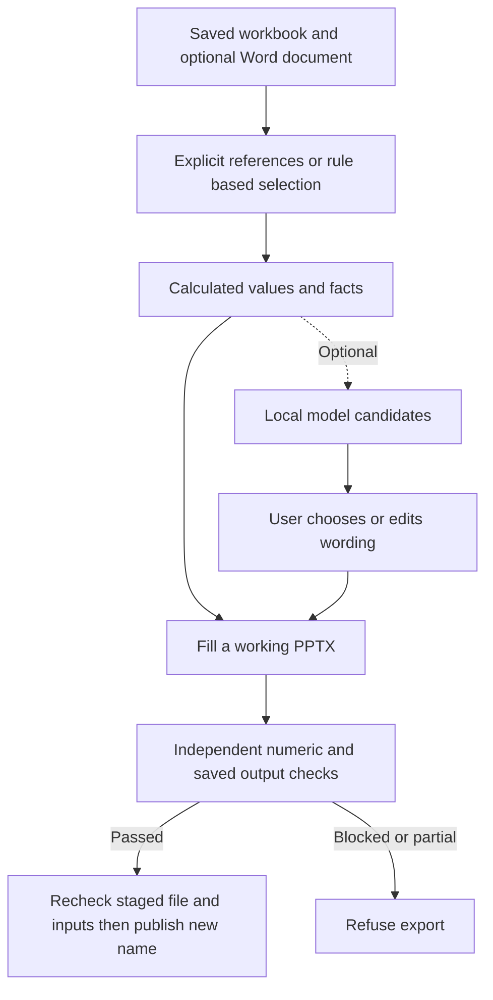

**English** | [한국어](feature-algorithms.ko.md)

# Feature principles, formulas and algorithms

This is a feature-by-feature reference for the development source at `d58471b`. The numeric hardening described here is **unreleased** and is not included in the published v0.3.0 executable. This document explains the implementation; it does not introduce new behavior or a new accuracy measurement.

The arithmetic, source selection, descriptive rules and optional model wording have different guarantees. Exact arithmetic establishes an answer to a declared calculation. It cannot establish that the chosen measure, source or business definition was appropriate.

## Feature map

| Action or feature | Processing | Details |
|---|---|---|
| Add/drop files, switch language, reopen app | File routing and local settings | [1](#1-file-reading-and-numeric-appearance), [14](#14-preview-numeric-verification-save-and-local-controls) |
| Workbook-only report / Change contents | Deterministic selection, explicit references, calculated preview | [2](#2-workbook-only-report-and-change-contents) |
| Existing template / Suggest references | Cell/name resolution and executable suggestions | [3](#3-cellname-references-and-existing-templates) |
| Latest values, filters and aggregation | Date ordering and explicit row operations | [4](#4-latest-values-and-calendar-selection), [5](#5-filters-sums-products-counts-and-means) |
| Changes, average comparisons, extreme dates | Declared arithmetic and observation windows | [6](#6-change-placeholders-averages-and-extreme-dates) |
| Ranks, shares, actuals vs budget | Item/total selection and comparison rules | [7](#7-item-ranking-shares-and-paired-measures) |
| Calculated report sentence / How to read it | Fixed descriptive rules, no model | [8](#8-calculated-notereading-seasonal-and-anomaly-rules) |
| Supported structured source tables | Bounded schema recognition | [9](#9-supported-structured-descriptive-tables) |
| Several workbooks / Word context | Compatible-direction rules and dated before/after windows | [10](#10-several-workbooks-and-direction-comparison), [11](#11-word-context-events-and-beforeafter-means) |
| Suggest insights (Ctrl+I) | Calculated candidates, optional local model, user choice | [12](#12-optional-insight-candidates-and-saved-choices) |
| Text, table, chart and number appearance | Format interpretation and PPTX writing | [1](#1-file-reading-and-numeric-appearance), [13](#13-writing-text-tables-and-charts) |
| Preview (F5), Generate (Ctrl+G) | Shared fill path, independent numeric checks, staged publication | [14](#14-preview-numeric-verification-save-and-local-controls) |



The diagram's check is the supported numeric contract. It does not prove every sentence or visual layout. Business-selection doubts, ordinary placeholder problems and numeric verification states are separate decisions.

## Notation and precision

- `x_1 ... x_n`: retained numeric observations after the selected filters/grouping, ordered by date; `d_i` is the date of `x_i`.
- `b`: a comparison base; `N`: an observation count. A missing value is not automatically zero.
- Main sums, products, means and changes retain rational intermediates. `Fraction(str(decoded_value))` preserves the decimal spelling supplied by the input decoder. It cannot recover digits lost before decoding.
- Some selection, prose and compatibility paths still use floating values or formatted numbers. Those are tested rules, not a proof that every application branch uses exact arithmetic.
- Formatting is a distinct operation. `General` deliberately limits displayed digits; a correct internal value need not be displayed with all its original digits.

## 1. File reading and numeric appearance

**Input:** XLSX/XLSM/XLTX/XLTM, XLS/XLSB/ODS, CSV/TSV/TXT; optional DOCX context. PPTX is the template/output format. There is no PDF/OCR input feature. Macros and CSV strings beginning with `=` are not executed.

XLSX-family input reads saved values through openpyxl. XLS uses xlrd; XLSB/ODS use calamine with explicit format, merge, time and error handling. An `.xls` extension is content-sniffed: it may instead contain XLSX, HTML tables or delimited text. Delimited input uses BOM/encoding checks and a separator count over the beginning of the file; this is parsing, not language-model inference. Leading-zero codes such as `007` are kept as text.

For calculations, recognized numeric text includes correctly grouped thousands, supported unit suffixes and losses such as `△500`, `−500` or `(1,234)`. Short `(1)` is not treated as a loss. Text `78.5%`, malformed grouping such as `1,2,3`, unreadable values and nonfinite numbers are not silently converted to usable figures. Warnings distinguish text-to-number conversion from a native numeric cell.

The number formatter interprets sign/zero sections, conditions, literals, dates, scientific notation, percent and thousands scaling. For `p` percent tokens and `s` trailing scale commas:

```text
displayed numeric magnitude = x * 100^p / 1000^s
```

For a supported fixed-decimal format with `k >= 0` places and `x = n/d`, rounding uses:

```text
a = abs(n) * 10^k
q = floor(a / d)
z = q + 1 if 2*(a - q*d) >= d, otherwise q
rounded = sign(n) * z / 10^k
```

Ties move away from zero: `2.675 → 2.68`, `-2.675 → -2.68` at two places. This is a display rule; the unrounded rational can continue through calculations. Structured decimal sums use a common decimal scale and generated integer summation.

`General` keeps whole integers below `10^15`, uses scientific notation at larger magnitudes or `0 < abs(x) < 10^-4`, and otherwise uses limited significant-digit precision (9 below 1, 10 otherwise). Unsupported formats fall back to a plain display with a warning. Locale-sensitive date separators/built-ins and supported number colors are handled separately; numeric output uses comma grouping and a decimal point. This is not a complete Excel renderer.

Code: [load](../readers.py#L609), [_text_cell](../readers.py#L61), [as_number](../core.py#L423), [figure_number](../core.py#L497), [format_value](../numfmt.py#L81), [_general](../numfmt.py#L501), [round_rational](../verification/kernel.py#L58). Tests: [Formats](../test_core.py#L44), [ExactReadings](../verification/test_reliability.py#L20).

## 2. Workbook-only report and Change contents

**Action:** choose files without a company template; use **Change contents (Ctrl+R)** to change the workbook-only selection.

The selector samples source cells and looks for explicit dates, labels, measures, totals and repeated structures. Its profile defaults are at most 3,000 rows, 60 columns and 25 heading rows. It excludes likely dictionaries, contents pages, identifiers and date attributes such as installation years. These tests use names and cell patterns; they can make the wrong business choice.

Candidate sheet order prefers visible data sheets, falling back to hidden ones only when no visible candidate exists. Numeric sheets precede date-only logs; actuals precede plans/forecasts; summaries and newer named years precede other sheets, then active-sheet/workbook order breaks ties.

The selected measure prefers explicit total measures where suitable and measures that still reach the newest period. Repeated additive rows tend to use `sum`; repeated levels/rates/prices tend to use `mean`; logs can use `count`. Conditions can select a stated whole instead of adding a total and its parts. The selection is converted to explicit reference strings and **actually calculated** through core before it is offered.

The standard dated proposal includes the latest value, calculated note/reading, comparisons and extreme dates, a latest-6 table and latest-12 chart. Small sets of related measures (2–4) can be shown together; very different scales are not automatically put on a common axis (the comparison uses a factor-of-10 rule). Compatible peer sheets can be included; large or dissimilar groups are not treated as a mandate to include everything. Supported structured schemas take precedence over the generic time-series/item route.

The bottom/status information states selected and omitted contents. Doubts include count-only choices, rates averaged without weights, mixed units, missing dates, implicit parent/child totals and ambiguous merged names. Keeping a doubt adds a qualification for that selection; it does not mathematically establish its business meaning. Changing a selection recomputes references and results.

With a company template, Ctrl+R opens **Suggest references** for the first workbook. It does not remap every placeholder in an arbitrary template. The GUI's custom-template path uses the first workbook; multi-file automatic reporting is a different route.

Code: [data_sheets](../suggest.py#L270), [read_shape](../suggest.py#L875), [default_value](../suggest.py#L935), [default_how](../suggest.py#L962), [default_conditions](../suggest.py#L1089), [find_doubts](../suggest.py#L1292), [plan_report](../suggest.py#L1701), [App.open_helper](../app.py#L818). Tests: [Suggestions](../test_core.py#L1531), [ReportReliability.test_rate_mean_requires_explicit_scope_review](../verification/test_reliability.py#L201).

## 3. Cell/name references and existing templates

**Text examples:** `{{Sales}}`, `{{Summary!B3}}`. **Shape markers:** put `{{table:Summary!A1:C5}}` or `{{chart:Summary!A1:C5}}` in a table/chart's Alternative Text description. Marker kind must match the shape type.

Resolution accepts explicit cells/areas, case-insensitive defined names (global then worksheet scope), and named Excel tables. Quoted sheet names and absolute `$` addresses normalize to source cells. Text placeholders require one resolved cell unless they invoke a supported calculated-text feature.

Dynamic named areas have a separate bounded interpreter: `OFFSET`, `INDEX`, `COUNTA`, `COUNT`, `ROWS`, `COLUMNS`, integer `+/-` and cell areas. For example, `OFFSET(Sheet!$B$1,COUNTA(Sheet!$B:$B)-1,0)` can select the last occupied row. This is not the same grammar as the independent saved-formula checker in section 14. A named formula that cannot resolve to supported cells is reported, rather than evaluated as arbitrary Excel code. The final dynamic area is limited to 200 columns and 1,048,576 rows; this is not a one-million-total-cell guarantee.

Code: [ExcelSource.locate](../core.py#L1451), [_dynamic_area](../core.py#L762), [_Run.fill_marked_shape](../core.py#L3392). Tests: [TextFill](../test_core.py#L260), [TableFill](../test_core.py#L329), [ChartFill](../test_core.py#L460).

## 4. Latest values and calendar selection

`{{latest:Daily!A,C}}` uses A as dates and C as values. `latest6` returns the newest six retained rows for a table/chart; a text placeholder normally requests one value. Row numbers describe transposed data (`Sheet!5,7`); bounded areas isolate one table; `A+B` or `A+B+C` describes split year/month[/day]; wildcard sheet names can join a declared series.

The resolver parses real dates and supported date text, examines candidate values, and sorts by date rather than worksheet position. Empty future rows and text-only future entries do not silently become numeric latest values. Source errors and formulas lacking saved results remain reportable. Conflicting latest values are ambiguous; numeric comparison series reject duplicate dates. Cross-sheet duplicate ownership is refused in grouped series.

Bare years are interpreted in year-dominated date lines. Yearless months use explicit heading/sheet context where plausible; otherwise the internal year 2001 orders the months without claiming that the source describes 2001. Fiscal labels are retained. A missing/conflicting fiscal year end prevents completion and period-comparison judgments.

Cadence is a heuristic based on sorted whole-day gaps among at most the latest 31 points. It takes `gaps[floor(length/2)]` (the upper middle element for an even count): daily=1; monthly=28–31; quarterly=89–92; yearly includes 365/366-day gaps and supported annual/partial-year patterns. There is no resampling, interpolation or automatic filling of missing days.

Completion uses the earlier of the workbook's saved-modified date and today, or today if unavailable. Period-end rules follow the detected cadence and fiscal evidence. A daily value on that same date warns as unfinished only when it is also at least 15% below its historical weekday level. These checks cannot prove source freshness or completeness.

Code: [ExcelSource._parse_ref](../core.py#L1576), [ExcelSource._latest_rows](../core.py#L1750), [ExcelSource._plain_series](../core.py#L2040), [ExcelSource._as_of](../core.py#L1816), [ExcelSource._period_issues](../core.py#L1821), [_usual_gap](../facts.py#L236), [unfinished](../facts.py#L355). Tests: [Latest](../test_core.py#L543), [DataShapes](../test_core.py#L1051), [ReportReliability.test_stale_unselected_date_cannot_hide_the_actual_latest_period](../verification/test_reliability.py#L171).

## 5. Filters, sums, products, counts and means

**Example reference:** `latest:Daily!A,sum(C, B=North)`. First retain rows matching the conditions, form a per-row contribution `u_i`, then group by calendar day or item label.

| Expression | Per-row contribution / group result |
|---|---|
| `sum(B:C)` | `u_i` is the sum of readable selected cells in row i; group result `sum(u_i)`. A row with no readable selected number contributes nothing. |
| `mean(B:C)` | The same row sums, then `sum(u_i)/m`, where m is the number of contributing **rows**. This is not the mean of every individual cell. |
| `sum(B*C)` / `mean(B*C)` | `u_i` is the product of all factors; skip the row if a factor is missing/unreadable. Sum or average the contributing products. |
| `count(B:C)` | Count rows having any selected cell nonempty, including text. This is not Excel formula `COUNT`'s numeric-cell count. |
| `rate(B=Done)` | Among nonblank B records after other filters, average `1` for a match and `0` otherwise. Blanks are excluded from this denominator. |

Zero is a real operand and counts in a mean. Missing values are not replaced with zero. With rows `(B,C)=(2,3),(4,blank)`, the row sums are 5 and 4: `sum(B:C)=9`, `mean(B:C)=4.5`; the complete product contributes 6 and the incomplete product row is skipped.

Conditions are case-insensitive and normalize supported year notations. If the requested word exists exactly in the domain, equality is required; otherwise the condition can use substring matching. Merged-cell origins are used. Thus `B=North` is not an unconditional exact-string SQL predicate.

In an explicitly grouped series, a date can cover subsequent blank-date rows until another date or a nonblank nondate boundary such as Total. This behavior differs from an ordinary unaggregated latest range, which does not silently add rows below a merged date. Totals/subtotals and overlapping sheets need their documented selection rules to avoid double counting.

**Rate definitions matter:** rows `100/100` and `0/900` have equal-row mean `(1+0)/2=50%`, but the combined rate is `(100+0)/(100+900)=10%`. `mean` and record `rate` do not invent weights. When the combined rate is required, supply explicit numerators/denominators, for example a supported source formula `SUM(C2:C3)/SUM(D2:D3)`. Automatic rate means raise a scope doubt.

Code: [_matches](../core.py#L1242), [_aggregate_value](../core.py#L1254), [ExcelSource._summed_series](../core.py#L2112), [value_spec](../suggest.py#L1140). Tests: [DataShapes](../test_core.py#L1051), [Remaining.test_randomized_group_sums_products_means_and_filtered_values](../verification/test_remaining.py#L166), [ReportReliability.test_rate_mean_requires_explicit_scope_review](../verification/test_reliability.py#L201).

## 6. Change placeholders, averages and extreme dates

For an amount, relative change is `r=(x_n-b)/abs(b)` and percentage display is `100*r`. A zero base withholds a relative change. Example: `100→120` is `+20.0%`; under this convention `-100→-50` is `+50.0%`. Named-item prose uses additional negative-base restrictions (section 7).

For a rate/score, the result is a difference: `points=(x_n-b)*s`, with `s=100` for fraction-valued percentage cells and `s=1` for values already in points. A plain amount-change column uses amount difference instead. `0.82→0.85` with percentage formatting is `+3.0 points`, not a 3% relative rise.

| Placeholder | Base/window and result |
|---|---|
| `prev` / `직전대비` / `전일대비` | Previous retained point. It is not necessarily yesterday. |
| `week` / `전주대비` | The point on `d_n - 7 calendar days`; no nearest-date substitute. |
| `avgN` / `평균대비N` | `b=(x_(n-N)+...+x_(n-1))/N`; default N=7. Excludes newest; withholds if N predecessors do not exist. |
| `peakN` / `lowN` | Max/min among the newest N points including current; default N=30. Latest tied point wins. Returns its **source date display**, not its numeric value. |

Use a positive N. An average base for previous values 100,110,120 is 110; a newest value 130 is `+18.2%` against that base. These are retained-point windows, not N consecutive calendar days. A missing base leaves a visible unresolved placeholder/problem. Small changes are called unchanged according to the actual one-decimal percentage rendering, so a half-tie rendered as `0.1%` is not called unchanged.

Code: [ratio](../facts.py#L120), [points_text](../facts.py#L152), [previous](../facts.py#L173), [week_ago](../facts.py#L177), [mean_before](../facts.py#L183), [extreme](../facts.py#L189), [ExcelSource._calc_text](../core.py#L2291). Tests: [Figures](../test_core.py#L746), [Calculations](../test_core.py#L865), [ReportReliability.test_numeric_calculation_text_is_independently_recomputed](../verification/test_reliability.py#L92).

## 7. Item ranking, shares and paired measures

Text `topN`, `topvalueN`, `shareN` selects rank N (default 1). In table/chart markers the same family requests the top N rows (default 5); `share` adds a share column. Named items sort by descending value, except catch-all Other/기타 is placed last. Equal sort keys keep source order. Separately, the newest time-series value's rank is `1 + count(values strictly greater)` in the newest 30 points, so ties share rank.

For an eligible additive measure, `share_i=x_i/T`. A declared total T is accepted as the common whole when `abs(T-sum(x_i)) <= 0.005*abs(T)`. An incompatible total withholds shares; no declared total uses a qualified “items' sum” rather than pretending the source declared a whole. Rates, means, prices, negative items, outlines and overlapping totals require additional eligibility rules. The app does not establish an accounting identity from a header alone.

Explicit totals/subtotals and supported hierarchy levels are kept out of the item sum where the selection recognizes them. Implicit parent/child matching uses a 0.1% tolerance and other safeguards (including minimum parent magnitude 100 for local matching). Unmarked sum-based structure raises a doubt because equality can be accidental. Separate totals such as income and expenses are stated separately.

Paired measures use the same change arithmetic, but relative growth prose requires positive bases and filters tiny items when naming largest movements (1% of the largest item). Absolute contribution and largest relative growth are distinct. Negative bases are shown as actual before→after values. Actual vs budget/target for the same period uses a plan comparison, not a historical growth claim or an automatic good/bad judgment.

Code: [rank](../facts.py#L223), [ranked_items](../facts.py#L721), [is_additive](../facts.py#L736), [without_parts](../facts.py#L804), [item_readings](../facts.py#L867), [ExcelSource._read_comparison](../core.py#L2354), [ExcelSource._rank_text](../core.py#L2557), [ExcelSource._rank_range](../core.py#L2580). Tests: [DataShapes](../test_core.py#L1051), [AutomaticGuard.test_split_dates_and_share_denominators_are_source_checked](../verification/test_automatic.py#L208).

## 8. Calculated note/reading: seasonal and anomaly rules

`note` produces a calculated report sentence; `reading` chooses observations about how to interpret it. Neither calls a model. Rules select a limited set of findings (normally up to three), not a free-form statistical analysis. Their priority matters when several findings apply.

For the newest weekday, let W be up to eight earlier values from that same weekday, with at least three values:

```text
L = median(W)
MAD = median(abs(w-L))
S = max(1.4826*MAD, 0.01*abs(L))
```

No usable spread means no usual-range result. The coefficient and thresholds are descriptive policy choices, not a fitted probability model or a confidence interval.

| Rule | Main condition / operation |
|---|---|
| Outside usual daily range | `abs(x-L)/S >= 3` and relative departure at least 7%. |
| Historical odd point | At least 3 spreads and 15% departure; the latest-7 search picks greatest absolute relative departure. |
| A point moved the mean | Counterfactual comparison excluding that odd point changes the percentage result by at least 2 percentage points. Original report values are not deleted/replaced. |
| Weekday/weekend effect | Compare means among latest 28 points; require weekday data and at least two weekend points; 10% difference threshold. |
| Conflicting comparison signs | Relevant comparisons point opposite ways, each at least 3%; daily weekend explanations also require the day-type effect. |
| Ordinary / large move | Usual-level fallback under 5%; large-move threshold 15%, with other context rules. |
| Run / recent position | Strict rises/falls stop at equality/reversal; seven-point total changes need 14 points; runs can be mentioned after three transitions; recent max/min/rank is also used. |
| Monthly/quarterly season | Find `(year-1, same month)`; no nearest period. Compare against that before drawing a conclusion from the preceding period. |
| Multi-year context | Three consecutive same-period moves or at least three earlier same-month years; below 70% of the previous same-month peak can be mentioned. |
| Calendar running total | At least 13 monthly points, no within-year fall, and at each observed year transition the new year's first observed value is at most half the preceding year's last observed value; at least one transition. The heuristic does not independently require complete January–December coverage. |
| Partial year | Compare `current/months_covered` with `prior_annual/12`; this is monthly normalization, not seasonal adjustment. |

Latest-7/28/30 windows count retained observations. The rules do not assume those points cover continuous calendar days. Fewer than three values can leave reading unresolved; 3–13 points can state that a usual level cannot yet be judged. A running or fiscally unresolved period has qualified wording/comparison restrictions. These rules do not forecast, test significance, identify causes or prove business appropriateness.

Code: [same_weekday](../facts.py#L208), [stands_out](../facts.py#L374), [week_total_change](../facts.py#L229), [year_ago](../facts.py#L306), [year_to_date](../facts.py#L325), [readings](../facts.py#L436), [fact_pack](../facts.py#L620), [ExcelSource._series_words_plain](../core.py#L2198). Tests: [Readings](../test_core.py#L4536), [SentenceAccuracy](../test_core.py#L4164). Background and historical tuning limits: [reading rules](how-it-works.md#reading-rules).

## 9. Supported structured descriptive tables

Schema recognition in `layouts.py` takes a separate route from generic sums/rankings. It reconstructs declared source roles and paginates at **eight data rows per page**.

- **Population-band rates:** explicit minimum/maximum headers followed by Food/Operations/Total triplets, with at least two valid bands. Lower/upper bounds are nonnegative integers; a stated upper must not be below its lower. Named exception rows retain their source values. When all three values are numeric, check `food+operations = stated total` using exact decimal summation. A wrong total is retained and disclosed, not silently corrected. An absent upper is “unstated,” not infinity; overlapping bands warn. Unit rates are not added into expenditure, and blank cells are not zero.
- **Organization/job blocks:** explicit Headcount/Quota roles plus merged organization headers; map Total/General/Special/Political slots and require unambiguous roles and numeric totals across at least two blocks. No new sum of departments and their totals is inferred.
- **Source row outlines:** adjacent Item/Value roles and actual outline levels 0–7. Preserve source rows and values, including totals; do not add every hierarchy level. Grouping metadata does not prove business membership.

The independent oracle separately reconstructs supported roles, rows, values, context and required known warnings. It does not recognize arbitrary spreadsheets outside those grammars.

Code: [_rates](../layouts.py#L107), [_organizations](../layouts.py#L167), [_outlines](../layouts.py#L220), [page_key](../layouts.py#L244), [expected](../verification/oracle.py#L26), [Session._layout](../verification/automatic.py#L74). Tests: [SourceAndOutput](../verification/test_verification.py#L122), [BinaryCoverage](../verification/test_binary.py#L98).

## 10. Several workbooks and direction comparison

Each file first produces its own calculated facts and retains its file/measure labels. Cross-file wording needs at least two usable percentage changes with the same latest period label and comparison basis. It prefers an existing year-over-year fact, otherwise a previous-period fact. Points-only changes are not treated as percentages.

For compatible entries it compares signs: all positive, all negative, all zero, or mixed. It does **not** compute correlation, regression, causation or significance. Importantly, the direction summary extracts percentages from already-formatted fact text with regex/float; a move rounded to zero can count as zero. This is not a new exact statistic over raw values. Different periods or `year`/`prev` bases produce an incompatibility note instead.

Code: [Sources._gather](../core.py#L3689), [_lead_change](../core.py#L3760), [cross_file_readings](../facts.py#L755). Tests: [CrossFileReadings](../test_core.py#L4123), [SeveralFiles](../test_core.py#L2642).

## 11. Word context, events and before/after means

DOCX is read as ZIP/XML text, not by running Word or a model. Supported dated paragraphs become events; short undated continuation paragraphs (at most 200 characters) between dated paragraphs can inherit the preceding date. A missing date day becomes day 1. Name matching is bounded text matching (Latin letter boundaries, Korean substring), not semantic entity resolution.

Candidate workbook series are limited to names actually mentioned in the document, with bounded source scanning. Let g be the median whole-day observation gap:

| Gap g | Points per side w |
|---|---:|
| `g <= 1` | 7 |
| `1 < g <= 8` | 4 |
| `8 < g <= 35` | 12 |
| `35 < g <= 100` | 4 |
| `g > 100` | 3 |

Choose index j as the first point on/after the event date; for `g>100`, use the first point whose year is on/after the event year. Skip point j. Require w points on each side, and reject a side spanning more than `(w-1)*g*1.5+1` days:

```text
B = mean(x_(j-w), ..., x_(j-1))
A = mean(x_(j+1), ..., x_(j+w))
change% = 100*(A/B - 1), only when B > 0
```

Both means zero yields no comparison. With nonpositive B, show the actual before→after means. Means display as whole numbers and changes with one decimal using supported half-away rounding. Mixed windows state their period count per row. This is an indexed date-boundary algorithm, not a general proof of which calendar period contains an event.

Duplicate links prefer the largest absolute mean movement. The standard table shows up to six links; highlights combine large absolute and relative movements, excluding very small bases from the relative shortlist. A temporal-association caution remains on the slide: this does not identify a cause.

Without useful links, the report selects original long paragraphs with priority for cautions/figures; it does not manufacture a summary. A separate numeric-overlap hint looks for distinct document numbers at least 1,000 in the workbook (also testing a `/100` representation and six-decimal-rounded values, excluding ordinary year integers). Under 30% overlap can trigger a different-scope caution. **This hint is not unit-aware source correspondence or the independent check of linked means.**

Code: [read](../documents.py#L93), [mentions](../documents.py#L165), [_window](../documents.py#L175), [link](../documents.py#L190), [highlights](../documents.py#L225), [key_paragraphs](../documents.py#L250), [check_figures](../documents.py#L325), [document_items](../suggest.py#L1813), [Session._document](../verification/automatic.py#L100). Tests: [WordDocuments](../test_core.py#L3956), [ReportReliability.test_document_mean_corruption_is_independently_detected](../verification/test_reliability.py#L229).

## 12. Optional insight candidates and saved choices

**Action:** select a figure and press Ctrl+I. The window first offers up to eight calculated candidates, then can request optional model wording. Core arithmetic does not invoke a model.

Language selection counts Hangul/Latin letters after machine-name cleanup; source sheet names and word cells near the top also contribute bounded votes so long identifiers do not dominate. Korean wins ties. Current code settings use A.X 4.0 Light for Korean and Qwen 3.5 4B for English. These are implementation settings, not recommendations or availability claims. Calls go only to the fixed localhost Ollama endpoint, with proxy handling disabled.

The model receives calculated facts, permitted fact IDs and a request for structured statements/supporting IDs/separate hypotheses. Defaults: three runs with consecutive seeds, temperature 0.2, context 4096 and prediction limit 900. Malformed output produces no candidate for that run; accepted statements are deduplicated. A hypothesis is shown for the person to check and is not automatically inserted.

The client filters known unsupported numbers, periods, directions, subjects, causes, evaluations and other observed misreadings. Number matching uses float-to-`g` normalization (normally six significant digits), **not the exact rational numeric guard**. These explicit filters do not prove every semantic claim. The editable chosen-text field is saved without rerunning the candidate filter; user edits are not semantically certified either.

Choices are stored by reference with:

```text
H = SHA256(lang + "\n" + join("\n", fact.id + ": " + fact.text))
```

Reuse requires the current displayed fact pack's fingerprint to match. Otherwise the calculated fallback returns. The hash covers these facts/language, not every raw source byte or every possible change in business meaning. The final guard preserves saved wording and audits declared inputs; it does not independently prove all chosen prose.

Code: [detect_language](../facts.py#L108), [fingerprint](../facts.py#L114), [make_candidates](../insight.py#L557), [check](../insight.py#L224), [_number](../insight.py#L203), [App.apply_insight](../app.py#L803). Tests: [Router](../test_core.py#L4840), [Candidates](../test_core.py#L4905), [InsightPlaceholder](../test_core.py#L4981), [SentenceAccuracy](../test_core.py#L4164).

## 13. Writing text, tables and charts

**Text:** adjacent runs are joined for placeholder matching; replacements proceed right-to-left and inherit the placeholder-start run's style. Text in slides/groups, tables, chart parts/titles, notes, masters/layouts and supported SmartArt is visited. SmartArt can discard a matched stale drawing copy so PowerPoint regenerates it from filled data. Unsupported values remain visible placeholders with problems.

**Tables:** columns must match; rows resize by cloning a body row, preserving a marked total row at the bottom. Supported merged heading prefixes remain intact; ambiguous body merges cannot resize. A latest/rank table may intentionally retain an existing template header. Height/overlap warnings estimate wrapped text from margins, font, character widths and line spacing. They do not certify native Office layout and remain distinct from numeric verification.

**Charts:** first row names series; first column supplies categories or X. Category charts preserve missing values as gaps. A template date axis receives actual dates only when all categories are dates; otherwise shown category text is used. XY keeps only complete X/Y points. Bubble expects X then Y/size pairs (`1+2*series_count` columns), nonnegative sizes and at least one complete point per series. Numeric text conversions warn; nonfinite values are not plotted figures. Rational values convert to float at the container boundary. Series number formats are supplied separately; chart type/design is retained while data, caches and the embedded workbook are replaced. Template axes/labels can still affect the visible result.

The guard requires exact integer survival and checks declared explicit-format precision against actual caches/embedded data. An exact table value such as `1000000000000000.05` can therefore be saved in a table while its chart is refused. General charts do not promise every source decimal digit.

**Contents-window sketch:** Ctrl+R's canvas is a schematic, not a native PowerPoint render. Long table strings can be shortened there. Its current chart-number filter accepts int/float only, so Fraction-valued derived series can be absent from that sketch even though the actual saved chart writer supports them. Do not use the sketch as a complete chart/number verification result.

Code: [replace_in_paragraph](../core.py#L2908), [_Run.walk](../core.py#L3464), [fill_table](../core.py#L3111), [fill_chart](../core.py#L3175), [check](../verification/charts.py#L38), [draw_chart](../contents.py#L85). Tests: [TextFill](../test_core.py#L260), [TableFill](../test_core.py#L329), [ChartFill](../test_core.py#L460), [ReportReliability.test_aggregate_table_preserves_small_amount_next_to_large_amount](../verification/test_reliability.py#L109).

## 14. Preview, numeric verification, save and local controls

F5 preview and Ctrl+G generation share `core.run`: fill a working copy, serialize a real PPTX, then audit it. Preview does not publish. Generation first previews and uses its source snapshot. Automatic reporting creates a temporary working template; source workbooks/documents/templates are read-only.

The session records source-file SHA256 fingerprints, explicit source recipes, changed paragraph strings, and table/chart bindings. Independent readers reconstruct declared source inputs; numeric `prev/week/avg/peak/low` text has a separate arithmetic reconstruction. Serialized table dimensions/strings and chart relationships, series/categories/points/gaps/caches/referenced embedded cells are checked. Word/layout paths have their own bounded checks.

### Saved-formula audit

The independent formula parser supports references/ranges, shared relative references, numeric comparisons, parentheses, `+ - * / % ^`, and `SUM`, `AVERAGE`, `COUNT`, `MIN`, `MAX`, `ABS`, `INT`, `ROUND`, `ROUNDUP`, `ROUNDDOWN`, `IF`, `TRUE`, `FALSE`. It follows the stated Excel grammar: `-2^2=4` and `2^3^2=64`. `INT` floors; `ROUND` ties away from zero; `ROUNDUP` moves away and `ROUNDDOWN` toward zero. Direct scalar coercion and referenced ranges have different supported rules.

Used dependencies include declared filter/date/label inputs and latest/rank selection domains, including unselected candidates. Cycles, arrays/data tables, binary formula expressions, external/unknown references/functions and unsupported coercions remain partial. ODS has only bounded normalization into this grammar. This compares saved caches; it does not run a full Excel engine or update the source workbook.

Budgets are 8,192 expression characters, 2,048 tokens, depth 64, 100,000 dependency cells, 65,536-bit rational results, integer powers of magnitude at most 1,000 and literal decimal exponents of magnitude at most 1,000. Numeric cache spelling is bounded before allocation. Exceeding coverage is not a pass. Integer comparisons are exact; noninteger cache/serialization checks use a two-ULP policy. Changed source-decimal normalization is limited to one input ULP and at most 17 significant digits; lost integers/higher unknown precision are not silently accepted.

### States and publication

| State | Meaning and action |
|---|---|
| Passed | Implemented checks passed for the declared supported numeric contract. Business doubts and visual warnings can still exist. |
| Partial | Independent numeric coverage is incomplete. Show reasons; refuse saving. |
| Blocked | A known mismatch/invalid evidence was detected. Refuse saving; this takes precedence over partial. |

The ordinary “continue despite problems” choice cannot bypass partial/blocked verification. It is a separate mechanism for ordinary unresolved placeholders; those can remain visibly unresolved. Likewise a selection-doubt confirmation does not certify scope or override the numeric guard.

Saving stages a temporary file beside the intended output, re-verifies it, checks staged bytes against the verified blob, checks sources again, then publishes only to a new destination. Windows rename refuses an existing destination; the other-platform path uses an exclusive link. Date and collision suffixes (`_2`, `_3`, ...) select new names. Hashes establish equality at check times, not a signature or a perpetual file lock.

The generated mathematical kernel has six executable contracts: integer Sum, sequence Same, SumBound, Within, RationalWithin and RoundScaled. The recorded Dafny result is **“9 verified, 0 errors” verification units**, not nine complete application algorithms. Parser correctness, input decoding, all selection/statistical rules, formatting and runtime remain separate tested/trusted boundaries. The developer certificate CLI also has a narrower structured-table contract than the GUI guard; it is not a generic chart certificate checker.

Other controls: Ctrl+E adds files, Ctrl+T chooses a template, Ctrl+L changes language, F1 opens help; Open report/folder opens an existing result/location. Background jobs use queues/job identifiers so superseded results are ignored; closing a window cancels its owned timers. Path/language/template-mode settings and chosen insight text are saved locally, beside the app when writable or under `%APPDATA%/SlideFill`. JSON is staged through `.tmp`; damaged settings can be moved to `.broken`. A settings-save failure does not prevent current-session work.

Code: [run](../core.py#L3856), [Session.verify](../verification/automatic.py#L153), [Session.publish](../verification/automatic.py#L257), [Audit.cell](../verification/formulas.py#L211), [expected](../verification/text_values.py#L13), [sum_rationals](../verification/kernel.py#L33), [output_path](../core.py#L3896), [settings_path](../core.py#L3910), [App.generate](../app.py#L676), [WindowTimers](../ui_timers.py#L5). Tests: [FormulaArithmetic](../verification/test_formulas.py#L19), [AutomaticGuard](../verification/test_automatic.py#L36), [ReportReliability](../verification/test_reliability.py#L72), [Settings](../test_core.py#L5301).

## Reading the evidence

Source/test links above identify implementation and regression coverage, not an accuracy percentage. See [development measurements](development-history.md), [verification boundaries](verification-design.md), [binary/rounding detail](binary-verification.md) and the [current numeric reliability contract](reliability-hardening.md). Original documentation retains the project's [MIT license](../LICENSE); existing component terms remain in [third-party notices](../THIRD-PARTY-NOTICES.md).
